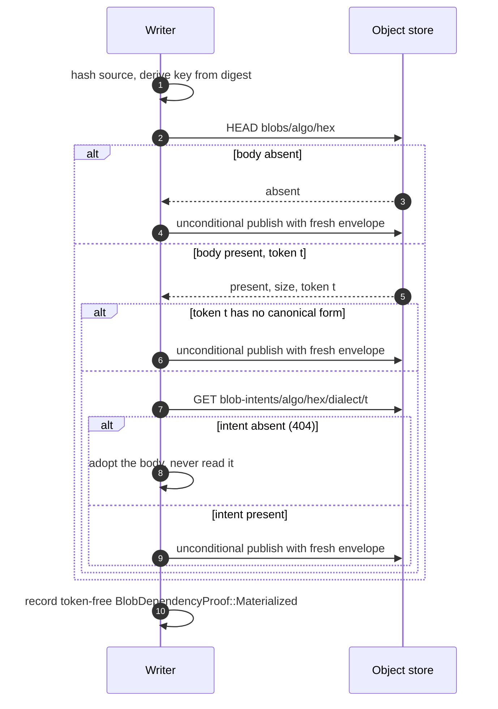

# CAS architecture — blob protocol {#blob-protocol}

A blob is the unit of content-addressed storage: one part file's bytes, keyed by a hash of its
own content. This page covers how a blob is published or reused, what a deletion intent is, and
how a writer and a `GC` round racing over the same blob are kept safe without ever comparing
multi-gigabyte bodies. Object layout and the durable object kinds are covered on the
[overview page](/antalya/cas/architecture/); `GC`'s fold and round structure is covered on the
[GC page](/antalya/cas/architecture/garbage-collection).

The protocol is generation 4 of the pool format. A pool below generation 4 is refused at every open
and is converted once, offline, by `clickhouse-disks cas-migrate-pool`
(see [migrating a pool to generation 4](/antalya/cas/operations/migration)). Servers of different
protocol versions never share a pool.

## Publishing and reusing a blob {#conditional-write-sequence}

Every blob body lives at a key derived purely from its content hash
(`blobs/<algo>/<hex[0:2]>/<hex>`, `Layout::blobKey`). Because the key already encodes the digest,
concurrent writers may safely replace one physical incarnation with another carrying the same
logical payload. Blob publication therefore needs no create-if-absent condition and returns no
incarnation token. A writer writes **one** object per new blob, the body, and never writes
metadata next to it.

`GC` warns about a blob it is about to delete by creating a [deletion intent](#deletion-intent):
a tiny object keyed by the exact incarnation of the body. A writer reads the intent to learn
whether the body in front of it may be reused.



Ordered steps in `PartWriteTxn::ensureBlobPresent`:

1. `requireAlive()` — the build is not abandoned, the namespace not dropped, the writer epoch
   still live. The precommit edge of the part is durable before the first blob request.
2. **Mandatory observation.** Every physical materialization begins with one blob `HEAD`, regardless
   of size, provider, staging backend, or whether another writer probably uploaded the same hash.
3. **Absent body:** publish. No other request.
4. **Present body:** the size is checked against the envelope and the source (a mismatch is
   `CORRUPTED_DATA`). The writer then needs the answer to one question: does an intent mark this
   exact incarnation for deletion? It sends `GET` for the intent of the token the `HEAD` returned.
   - **404:** no intent exists for the incarnation the writer saw. That does not prove no round condemned it: a
     transition deletes the old intent after condemning the new body. The writer adopts the body, because its
     precommit edge was durable before the `HEAD`, so the next destructive cut counts it (see
     [the writer-versus-GC race](#writer-gc-race)). It records a `Materialized` dependency proof without retaining
     the token (event `blob_reuse_adopt`, counter `CASBlobBodyPutAvoided`).
   - **The intent exists:** the body may be about to be deleted. The writer publishes its own
     source bytes under a fresh `incarnation_tag` (event `blob_reuse_resurrect`, counter
     `CASBlobReuseIntentPresent`). It never reads or revives the condemned body.
   - **The token has no canonical form** (a well-formed token that names no incarnation, such as a
     weak `W/` ETag): no intent can be keyed by it, so the body is never adopted. The writer publishes
     (counter `CASBlobReuseTokenRejected`, one `ERROR` line per mount).
5. **A read without a usable answer** — a `HEAD` or intent `GET` that is refused or unanswered — fails
   the part write. It is never read as absence.
6. Streaming publication mints a fresh `incarnation_tag`, verifies the payload hash against the
   key's digest before the object completes (a mismatch is `CORRUPTED_DATA`, counter
   `CASBlobPublishDigestMismatch`, nothing is published), and can use ordinary multipart. The
   first publication of an S3-staged source may use native same-store copy only after the `HEAD`
   answered absent; that copy is not hashed. A later publication opens the staged payload,
   retags and streams it. The request that creates the object (`PutObject`, `CopyObject`,
   `CompleteMultipartUpload`) is never resent by the S3 client after an ambiguous outcome;
   resends after a definite refusal, such as expired credentials or a redirect, stay. Part uploads keep the
   client's retries.
7. `BlobSource::beginPublication` consumes the shared, monotonic `publication_attempted` state
   before backend I/O. A lost response cannot re-enable verbatim copy on a later attempt.
8. Retryable or ambiguous failures restart at `HEAD`: up to 8 attempts, each with a fresh envelope.
   The engine starts no new attempt after the configured request window (`cas_request_window_ms`,
   default 120 s), but an attempt already started can run longer: each creating request waits up to
   the disk's `request_timeout_ms`, and multipart part uploads keep their own retries. A write can
   therefore take longer than the request window before it fails with a retryable error. No
   dependency proof is recorded until the body was adopted or the publication completed.

**Reads go to the store.** The `HEAD` is sent after the precommit edge is durable, and the intent
`GET` after the `HEAD` answered. No cache answers either, and no step reuses the answer of a request
sent before the event it must follow.

**Two writers uploading identical content** may both observe absence and both publish. The last
physical incarnation wins, but the key proves that both payloads have the same logical identity and
durable references name that identity, not an ETag or generation. Each writer records only a
`Materialized` proof. Its durable precommit edge protects the logical blob while the physical race
settles (see [the writer-versus-GC race](#writer-gc-race)).

### Request budget {#request-budget}

Requests per blob and writer attempt, on the successful uncontended path. Everything is on the blob
or intent key unless the last column says otherwise.

| Case | Requests | Other requests |
|---|---|---|
| First creation | `HEAD`, body `PUT` | S3 staging: one staging `GET`; staged copy: one staging `HEAD` |
| Reuse of a body with no intent | `HEAD`, intent `GET` (404) | none |
| Reuse after condemnation | `HEAD`, intent `GET` (200), body `PUT` | S3 staging: one staging `GET` |
| A token that has no canonical form | `HEAD`, body `PUT` | S3 staging: one staging `GET` |

One publication counts as one `PUT` whatever its transport (`PutObject`, multipart upload,
`CopyObject`). All blob tasks remain in the bounded `cas_blob_upload_pool_size` fan-out rather than
serializing the part. A blob that is created once, reused `k` times and then reclaimed costs
`7 + 2k` requests in total, writer and `GC` together.

## Dedup and the identity primitive {#dedup-identity}

Two blobs are the same object if and only if they hash to the same digest under the pool's
configured algorithm. Nothing else — not size, not `LIST` order, not a cheap prefix compare —
is allowed to stand in for that check. This follows the same rule everywhere in CAS: identity
is *proven* by hash equality, never *inferred* by a cheap signal, and re-hashing on read is the
identity primitive wherever the correctness of a decision depends on it.

The blob content hash is pluggable per pool, fixed at pool creation: `cas_blob_hash` selects
`cityhash128` (default), `xxh3-128`, or `sha256` (`parseBlobHashAlgo`,
`Primitives/CasBlobDigest.h`). A blob is identified by the pair `BlobRef = (BlobHashAlgo, digest)`,
never by a bare digest — a bare digest is ambiguous once more than one algorithm can appear in a
pool. `cas_blob_hash_allow_new` gates admitting a second algorithm into an already-populated pool's
`algos_used` set; it defaults to off.

`cityhash128` is not cryptographically collision-resistant. A pool whose users are mutually
untrusted, and insert only through trusted servers, should run `sha256` — CAS enforces no policy choice here; the operator picks
the threat model via `cas_blob_hash`. This is why the materialization gate is a `HEAD` (occupancy)
rather than a body compare: it tells the writer *something* already claims this key, and the
digest is the only claim CAS trusts.

## The deletion intent {#deletion-intent}

A deletion intent is the warning `GC` leaves before it deletes a body. It is one small immutable object
per condemned incarnation:

| Aspect | Value |
|---|---|
| Key | `blob-intents/<algo>/<hex[0:2]>/<hex>/<dialect>/<tag-hex>`: the blob's own path segments, then the [canonical identity](#token-identity) of the body's token |
| Bytes | A constant record under 40 bytes. It holds no round, size or token: the key is the identity |
| Created by | `GC` (and `cas-migrate-pool`), with `If-None-Match`. An existing object with the same bytes counts as confirmation |
| Deleted by | `GC` only, never a writer and never `cas-fsck` |
| Read by | Writers (one `GET` per reuse), `GC`, `cas-fsck` (one `GET` per `pending` row; with `--verify-intents`, one `GET` and one `HEAD` per well-formed intent) |

An intent names one incarnation, so a body replaced by a writer is not covered by the old
intent: the replacement has another token and therefore another intent key.

**An intent can outlive its body, and must.** `GC` removes it only after the incarnation it names is
gone from the key: once the body is gone and a later round's reference cut still shows no reference,
or, for a blob referenced again, once a `HEAD` sent after the round's cut shows another token. A
writer that observed the body before it was deleted, and reads the intent afterwards, would otherwise
find nothing and adopt a body that no longer exists. An intent can also outlive a *live* body: a blob
that is referenced again while its body still has the condemned token keeps its intent, and the next
writer that finds the body uploads it once more instead of adopting it. Such an intent with no `GC`
state is an [orphan](/antalya/cas/architecture/garbage-collection#orphan-intents) that a later round
adopts and removes once the blob is unreferenced again.

## The writer-versus-GC race {#writer-gc-race}

This is the interleaving that gets the most reviewer attention, because a writer and a `GC` round
can legitimately disagree about whether a blob is still needed. `GC` reclaims a blob over three
rounds, each deciding from a reference cut taken in that round:

```mermaid
sequenceDiagram
    autonumber
    participant W as Writer
    participant S3 as Object store
    participant GC as GC leader

    Note over GC: round n -- the cut shows in-degree 0
    GC->>S3: HEAD blob -- body has token t1
    GC->>S3: PUT blob-intents/.../t1 (If-None-Match)
    Note over GC: commit records pending(t1)

    rect rgba(120,160,255,0.12)
    Note over W,S3: a writer arrives wanting this content
    W->>S3: append ref-log PRECOMMIT (durable +1 edge)
    W->>S3: HEAD blob (present, token t1)
    W->>S3: GET intent for t1
    alt intent absent
        W->>W: adopt the body; next cut sees in-degree >= 1
    else intent present
        W->>S3: PUT blob unconditional re-upload, fresh incarnation tag, token t2
    end
    end

    Note over GC: round n+1 -- the cut still shows 0
    GC->>S3: HEAD blob
    alt still t1
        GC->>S3: DELETE blob If-Match t1
        Note over GC: commit records standing(t1)
    else replaced by t2
        GC->>S3: PUT intent for t2, DELETE intent for t1
        Note over GC: commit records pending(t2)
    end

    Note over GC: round n+2 -- a cut taken after the standing commit still shows 0
    GC->>S3: DELETE blob-intents/.../t1
    Note over GC: the row is dropped
```

`GC` keeps one row per blob: `candidate(t)` while the intent for `t` is not confirmed, `pending(t)` once it
is, and `standing(t)` once the body is gone or was replaced and the intent still stands. The transitions
are in [condemnation and deletion](/antalya/cas/architecture/garbage-collection#condemn-delete).

The invariant that makes every interleaving safe: **revival is re-publication only — never `GET` a
condemned object to revive it.** A writer that finds an intent does not reuse the existing body;
it re-uploads its own source bytes under a fresh `incarnation_tag`, producing a new token that no
prior exact-token delete can name. `GC` never streams a body it might delete, and a writer never
trusts a body it did not itself just write.

Why this closes the race in both directions:

- A writer that **adopts** a present body read the intent of `t` as absent, for one of two reasons:
  - The intent was not created yet. The writer's precommit edge was durable before that read, so it
    was durable before the round that created the intent committed. The round that deletes the body
    takes a later cut, sees the edge, and spares the blob.
  - A spare or a transition deleted it, which each does only when its `HEAD`, sent after its cut, shows another
    token `u`. A token never recurs at a key, so `t` cannot come back and the body the writer adopts is `u`
    or a later one. The writer's `HEAD` saw `t`, so `u` landed after that `HEAD`, and the writer's
    edge was durable before it. A body `u` is deleted only by a round after the one that observed `u`
    and committed `pending(u)`, so the deleting round's cut is taken after `u` landed. It sees the
    edge and spares the blob.
- A spare whose `HEAD` shows **no body** keeps the intent. A writer whose `HEAD` saw `t` before the
  body was deleted may not have read the intent yet; without it, the writer would adopt a body that
  is gone. Another token proves `t` was replaced; an absent body does not.
- A writer that **replaces a condemned incarnation** changes the token. A stale exact-token delete
  of `t1` then answers `Mismatch` and reclaims nothing — the delete names an exact incarnation,
  never "the object at this key". The next round sees the new token `t2` at zero in-degree and
  condemns it, with its own intent.
- The intent outlives the body until a cut taken after `standing` was committed still shows no
  reference. Any writer that read the old body has its edge in that cut, so the blob is spared.
- `GC` never removes an intent because a body is absent, and never in the job that deletes the
  body. A request that is refused or unanswered fails the round before its commit and the row keeps
  its state; a missing answer is never read as absence.
- A round whose destruction is suppressed (an anomaly, a hold, an incomplete frontier, or a `gc/state` that no
  longer shows the leased version) deletes no body and no intent. Fresh condemnations and transitions still create
  intents and write rows; a carried `candidate` row waits for an unsuppressed round to create its intent.

Both directions degrade to a spurious re-upload or a no-op delete. Neither can lose data or leave
a dangling manifest entry.

**One asymmetry worth flagging:** on a local emulated disk `publishBlob` materializes the full
`[header][payload]` in memory. These publications are serialized, so at most one body is held whole
in RAM at a time. Native object storage streams and can use multipart.

### Copies that do not read the body {#copies-without-reading}

`GC` deletes a body only when its round saw no owner of the blob: the blob had no source edge in the parent state,
and the round folded no record of it in any namespace it read after acquiring its lease.

A copy of a part that reuses the body without reading it (`ATTACH PARTITION FROM`, `MOVE PARTITION TO TABLE`,
`RENAME TABLE` across tables, a fetch by relink) needs a source that stays live until the copy's own edge is durable.
So a chain of such copies starts either from an owner that existed when the round read the catalog, which contradicts
"no owner", or from a writer that arrived after that read. That writer meets the intent while the old body is current and uploads a fresh incarnation, which a delete
naming the old token cannot remove. To keep the source live, `createHardLink` and `republishRef` confirm it after the
destination precommit and before the promote; an unconfirmed source fails the copy with `NO_REPLICA_HAS_PART`, which
the replication queue and mutations retry and a user statement returns.

### Token identity {#token-identity}

An incarnation is identified by its **canonical identity**: the pair of the pool's token dialect
(`etag`, `generation` or `emulated`) and the lowercase hex of the opaque tag, with at most one pair
of surrounding double quotes removed. Intent keys, row matching and the `cas-fsck` classes use it.
The raw token, as the store returned it, is used only as the `If-Match` value of an exact delete.

- A token that is well formed but names no incarnation (a weak `W/` tag, a tag with a comma, an
  empty or oversized tag) never gets an intent. Writers publish instead of adopting, `GC` never
  deletes such a body. The counters `CASBlobReuseTokenRejected` and
  `CASGCIntentTokenRejected` show it.
- The dialect is recorded once in `_pool_meta` when the pool reaches generation 4. Every open of the
  pool, writable or read-only, and every tool is refused unless its backend uses the recorded
  dialect.
- Correctness rests on a body token never recurring at a key. A store whose tokens can recur must
  not host a pool.

## Deterministic artifacts and the adoption pin {#deterministic-artifacts}

Some CAS objects are a pure function of their inputs: the `GC` source-edge run files (`cas_run`)
and fold seals (`cas_fold_seal`). For these, `putDeterministicArtifact`
(`Gc/CasBlobInDegree.cpp`) is the write-once helper:

```cpp
if (backend.putIfAbsent(key, bytes).outcome == PutOutcome::PreconditionFailed)
{
    const auto existing = backend.get(key);
    if (!existing || existing->bytes != bytes)
        throw Exception(ErrorCodes::CORRUPTED_DATA, ...);
    /// byte-equal => our own deterministic replay; adopt (no-op).
}
```

The idempotency argument: identical inputs produce byte-identical output, so a replayed round —
leader deposed mid-round, round `CAS` aborted, crash-restart — re-derives exactly the same bytes.
A 412 therefore means "already occupied by our own replay", verified by comparing the fetched
bytes, not inferred from occupancy alone as blob uploads do. Divergent bytes are impossible under
correct operation and fail closed as `CORRUPTED_DATA`.

This is the format-evolution **adoption pin**, documented in the persisted-format registry
(`Formats/README.md`): on a `putDeterministicArtifact` conflict, the writer re-encodes at the `v`
of the *existing* object rather than at its own current build's version, so two writers on
different builds replaying the same deterministic round still land on byte-identical output.

The helper is explicitly **not** for observation-bearing artifacts — `GC` outcome logs carry
`HEAD`-observed tokens on which two observers may legitimately disagree, so those use
first-durable-write-wins byte-adopt semantics instead. And a blob body can never use this path:
the fresh-tag rule means two attempts at the same logical create are allowed to legitimately
differ, which is exactly what `putDeterministicArtifact`'s divergence check would reject.

## Settings {#settings}

The disk configuration element is shared by several consumers. The `CAS` settings below carry the
`cas_` prefix; the deliberately bare `gcs_max_conditional_put_bytes` is an S3 client setting.

| Setting | Controls | Default |
|---|---|---|
| `cas_blob_hash` | Pool blob content-hash function (`cityhash128` \| `xxh3-128` \| `sha256`); fixed at pool creation | `cityhash128` |
| `cas_blob_hash_allow_new` | Explicit opt-in to admit a new hash algorithm into an existing pool's `algos_used` | `false` |
| `cas_staging_backend` | Blob staging backend (`local` \| `s3`); `s3` is opt-in | `local` |
| `cas_scratch_path` | Server-local scratch directory for the local-staging write-buffer spill; a relative value is anchored to the server data path | `<clickhouse-path>/disks/<disk_name>/cas_scratch/` |
| `gcs_max_conditional_put_bytes` | Largest conditional non-blob `PUT` on a generation-token store, covering create-if-absent artifacts and conditional replacements; unconditional blob publication is not subject to this cap | 1 GiB |

`GC`-round budgets that gate condemnation and reclaim of these same blobs (intent creates, body
deletes, intent sweep) live on the GC architecture page, not here — they govern the `GC` side of the
race in [Writer-versus-GC race](#writer-gc-race), not the write path.
