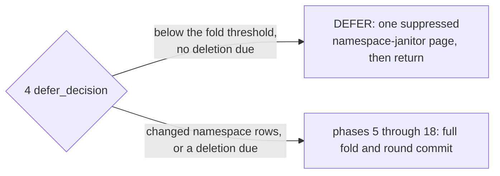
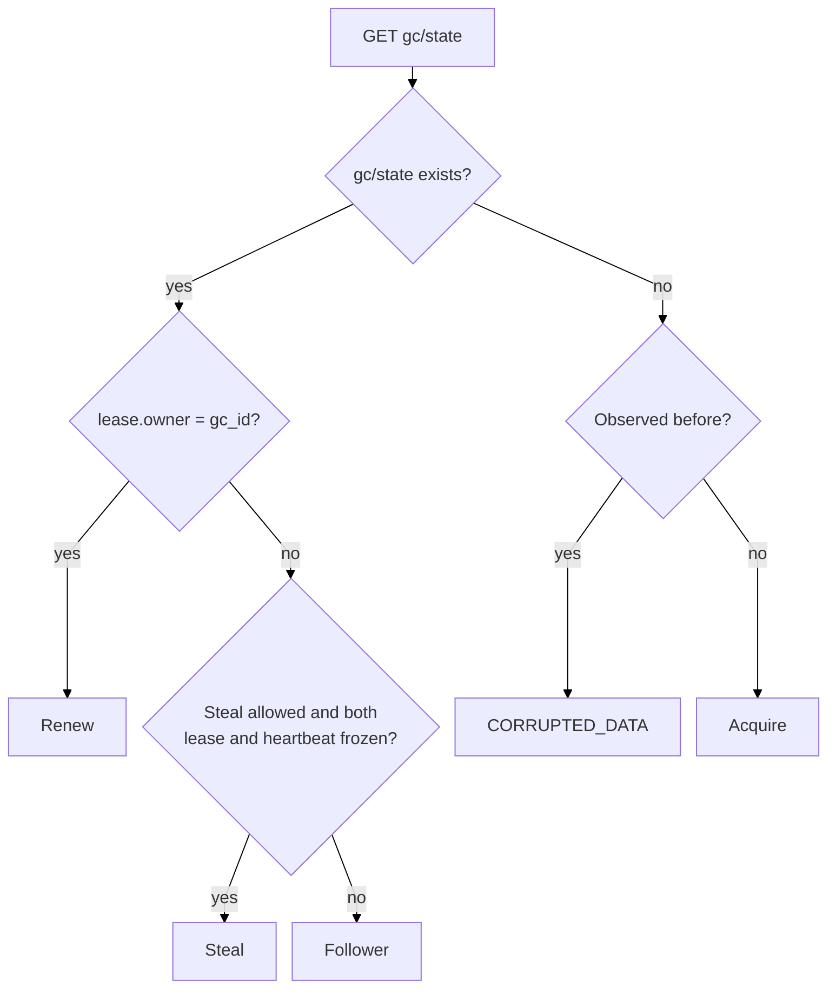

# CAS architecture — garbage collection {#garbage-collection}

## GC model {#gc-model}

`GC` is the only place in `CAS` that ever deletes a blob body, and the only reachability-driven
deleter of manifest bodies (a writer may exact-delete its own never-precommitted staged manifests
when it abandons a transaction, and `SYSTEM CAS DROP POOL MEMBER` sweeps a dead member's manifest
debris; neither consults in-degree). It runs as a
background, lease-paced loop per mount (`Gc::runRegularRound`, `Gc/CasGc.cpp`), folding ref-log
history into blob in-degree, condemning what reaches zero with a deletion intent, and deleting a
body only in a later round whose cut still shows no reference. Each call to `Gc::runRegularRound` is one round
execution. It first processes the `GC` lease by creating, renewing, observing or stealing it, then
either returns as a follower, defers the fold when no destructive decision is due, or folds ref-log
history into a new in-degree snapshot and publishes it.

The [`cas_gc_interval_sec`](/antalya/cas/configuration#disk-settings) disk setting controls the
normal interval between background round executions (60 seconds by default). It is a scheduler
cadence, not a limit on the duration of one round execution. Round duration depends on the amount
of ref-log, manifest, candidate, and cleanup work and on the configured per-round work budgets. A
manual `SYSTEM CAS GC RUN` can request a round execution without waiting for the interval.

This page covers leadership, the round's 18 phases, condemnation and deletion, sharding, pruning,
round cost, and observability. Manifest and ref mechanics that `GC` folds are covered on the
[manifests-and-refs page](/antalya/cas/architecture/manifests-and-refs); the writer-versus-`GC`
race over one blob is covered on the
[blob-protocol page](/antalya/cas/architecture/blob-protocol#writer-gc-race).

## The round {#the-round}

A folding round execution is one pass of 18 named phases ending in exactly one commit `CAS` over
`gc/state` (`Gc::runRegularRound`, `Gc/CasGc.cpp`). Every round execution starts with phase 1, but a
follower or a deferred round execution returns before that commit.

| # | Phase (`GcPhaseTimer` name) | Runs on | What it does |
|---|---|---|---|
| 1 | `lease` | always | Create, renew, observe or steal the lease inside `gc/state`. The only phase a `NotALeader` round emits |
| 2 | `pre_fold_ref_drain` | leader | Resolve catalog `Removing` rows whose cleanup evidence the adopted parent already sealed; drop the completed ones, and cancel `Creating` rows whose creator's mount slot proves it cannot finish, before defer or new fold work |
| 3 | `heartbeat_floor` | leader | One `LIST` of `gc/server-roots/`, one `GET` per mount slot, fence-out `PUT` for any mount whose write-token has held stable past the threshold |
| 4 | `defer_decision` | leader | One full `LIST` of `cas/ns/stream/`, build the catalog-keyed ref walk plan; decide `DEFER` (fewer changed rows than the fold threshold, no deletion due, defer limit not reached) or continue to a full fold |
| 5 | `parent_seal_read` | fold | Capture the parent fold seal's run references before the fold mutates the in-memory generation/attempt |
| 6 | `fold_ref_group` | fold | Regroup the one `LIST` from phase 4 into per-namespace listings — no I/O, the keys are already in hand |
| 7 | `fold_seal_read` | fold | `GET` and decode the adopted fold seal that anchors this fold's coverage |
| 8 | `fold_ref_intake` | fold | `GET` every new ref-log record and every referenced manifest, extracting blob source edges |
| 9 | `intent_sweep_list` | fold; absent from a round whose destruction is suppressed | One `LIST` page of `blob-intents/` from the stored cursor, nominating [deletion intents](#orphan-intents) that have no row |
| 10 | `fold_reduce` | fold | Merge prior edges, new deltas, the parent's rows and the nominated intents: create an intent for each blob that reached zero, spare referenced blobs, decide body and intent deletes, adopt orphan intents |
| 11 | `fold_seal_write` | fold | Write the new fold seal once, write-once deterministic, adopting a byte-identical replay instead of rewriting it |
| 12 | `pending_deletes` | fold | Delete blobs from previously committed `pending` rows in conditional chunks using the tokens from phase 10, then remove eligible deletion intents and write the outcome logs |
| 13 | `round_commit` | fold | Retention-prune old generations, then publish the single `gc/state` `CAS` that adopts the whole round |
| 14 | `handoff_reclaim` | post-`CAS` | Reclaim a generation a ref moved off during this round, which the ordinary retention prune already skipped and will not revisit |
| 15 | `manifest_deletes` | post-`CAS` | Delete manifest bodies whose owner-removal minus-one edge the `CAS` in phase 13 just adopted |
| 16 | `namespace_cleanup` | leader; suppressed on `DEFER` | Pages of the perpetual namespace janitor under a 20 s soft budget, reclaiming dead-life debris |
| 17 | `ref_object_cleanup` | post-`CAS` | Prune ref logs and snapshots once both fold coverage and a live snapshot make them safe to delete |
| 18 | `orphan_sweep` | post-`CAS` | Exact-token deletion for the [orphan-manifest sweep](/antalya/cas/architecture/manifests-and-refs#orphan-sweep), after phase 13 adopted each candidate's blob-source retirements and the cursor |

Phases 2 through 4 run on every leader round; a follower returns after phase 1. Phases 5–15 and
17–18 run only when phase 4 decides to fold (phase 9 only when the round does not suppress destruction); phase 16 runs after phase 15 on a fold and right after
phase 4 on a `DEFER`. A `DEFER` verdict is therefore not a bare no-op: it still runs one bounded
namespace-janitor page with `suppress_destructive = true` — listing and classification only, no
deletes and no cursor advance — and then returns, publishing no fold artifact and no commit `CAS`.
Its lease `CAS` may already have created or renewed the lease in phase 1:

Orderings that are load-bearing:

- **2 before 4** — a row proved complete by the adopted parent is resolved before `DEFER` or any
  successor plan can publish.
- **15 after 13** — manifest bodies are deleted only after the `CAS` adopted their decrements.
- **13's prune before the `CAS`** — a pre-`CAS` destructive action may rely only on already-
  published state.

**Clamp suppression.** `suppress_destructive = !anomalies.empty() || !carried_holds.empty() ||
!frontier_complete || stop_requested || parent_unconfirmed` is computed once and threaded into the merge, current-life ref cleanup
and the perpetual namespace janitor, so they cannot desynchronize. `stop_requested` is true when the round saw a
stop request before its final intake poll. Under suppression no blob body and no
deletion intent is deleted, no intent is listed for adoption, and there is no ref or namespace
deletion. Fresh condemnations and transitions still create intents and write rows, and sparing continues,
because none of them removes anything a writer relies on. A carried `candidate` row waits for an unsuppressed
round to create its intent.

**Fail-closed aborts.** A throw before the commit `CAS` means no successor state is adopted (the
exact-token deletes and prune that earlier phases justified from *previously* published state may
already have run; they are idempotent): unapplied transactions and a cursor/apply mismatch (both
`CORRUPTED_DATA`, checked between phases 10 and 11), a missing adopted seal, a table with a snapshot
but no surviving log and no cursor, a non-total condemned summary (all `CORRUPTED_DATA`), and an
observed delete marker (`CAS_DELETE_MARKER`). The per-phase "fails the round
if" lists below name the protocol checks; an uncaught backend or decode exception fails the round
execution too.

## Phase 1 — lease {#phase-1-lease}

Establishes whether this GC may run the round. There is no separate lease object: the lease lives
inside `gc/state` as `{owner, seq}`, and a round is authorized by winning a token-guarded `CAS` on
that object.

- **Runs on:** always — the only phase a `NotALeader` round emits
- **Reads:** `gc/state`; `gc/hb` (only when another GC owns the lease)
- **Writes / deletes:** one successful `CAS` on `gc/state` (acquire, renew or steal); a conflict is
  re-observed and re-decided by the request engine within the configured request window (`cas_request_window_ms`, default 120 s); no
  deletes
- **Safety:** the lease is *work de-duplication, not mutual exclusion* — see below
- **Fails the round if:** this `Gc` instance saw `gc/state` before and it has since disappeared, or
  the `gc_shards` in `gc/state` disagrees with the pool's `_pool_meta` value (both `CORRUPTED_DATA`)
- **Observability:** phase row `lease`; metrics `acquired`, `steal_allowed`

**Acquire / renew.** If `gc/state` is absent and never seen, this GC creates it with `owner = gc_id`,
`seq = 1`, and fixes `gc_shards`. If `lease.owner` is already this `gc_id`, it increments `seq` with
a token-guarded `CAS`. Non-lease fields are always preserved; a conflict causes a bounded re-read.

**Follower / steal.** If another GC owns the lease, this GC reads `gc/hb` and normally returns
`NotALeader`. The leader advances an advisory `gc/hb` object; the heartbeat proves activity but
grants no authority. A candidate compares `(lease.owner, lease.seq)` and the `gc/hb` writer/sequence
against what it recorded on its *previous* scheduled round. If either signal moved, the owner is
live and the candidate records a fresh observation and backs off. A steal is allowed only when both
signals stayed frozen across two paced observations; the candidate then rewrites `lease.owner`,
increments `seq`, and `CAS`es. A conflict is re-observed and re-decided; if the refreshed state
shows a live incumbent the steal declines and returns `NotALeader`. A new process has no
recorded observations, so it can never steal on first sight. A manual `SYSTEM CAS GC RUN` may
acquire or renew but never steals.

**A lease that was never held.** A `gc/state` whose lease reads `owner = 0` and `seq = 0` was written by no GC:
`cas-migrate-pool` leaves it on a pool that never ran one. Any caller takes it with the conditional write at once,
a manual run included, because `gc_id` `0` is reserved and no incumbent can be alive. A lease that has ever been held
is never taken that way.

**The `CAS` token.** Acquire / renew / steal return the `gc/state` version's backend token; phase 13's
commit `CAS` uses it, so any intervening write to `gc/state` rejects a stale leader's commit. The
resulting `lease.seq` is the folding round's attempt id.

**Safety after leadership changes.** A deposed leader may keep running; correctness does not need
exclusive execution:

1. a folding round is published by exactly one commit `CAS` — a deposed leader's commit fails and
   its candidate generation is never adopted;
2. every fold artifact is written under that leader's own attempt number, invisible to readers and
   reclaimed by generation pruning;
3. destructive pre-`CAS` actions are justified only by previously published durable state, so they
   are replay-idempotent;
4. deletes are exact-token, so a stale leader can never delete a newer incarnation.

## Phase 2 — pre-fold ref drain {#phase-2-pre-fold-ref-drain}

Finishes namespace removals that the last committed fold already proved safe: removes the matching
`Removing` row from the ref catalog. Removal is split across rounds — one fold writes
`cleanup_evidence` into its seal, a *later* round's phase 2 acts on it — so phase 2 never trusts
evidence from the fold running now.

- **Runs on:** always (leader), including on a round that later returns `Deferred`
- **Reads:** the adopted fold seal (`ref_lives` coverage + `cleanup_evidence` only); the ref
  catalog; `gc/state` (leadership re-check around every write)
- **Writes / deletes:** rewrites the ref catalog via `CAS` to drop each eligible row (not a backend
  `DELETE`); no blob, manifest or namespace-object deletes
- **Safety:** a row is dropped only if the adopted parent seal carries `cleanup_evidence` for the
  *same* `incarnation` and that life has no coverage hold; each write is token-guarded and bracketed
  by two `gc/state` re-reads
- **Fails the round if:** `gc/state` points at a missing parent seal (`CORRUPTED_DATA`, or `ABORTED` when a `HEAD`
  of `gc/state` then shows another version or no object: the leadership was lost); leadership changes mid-drain (`NETWORK_ERROR`, an `Aborted` finish that the next round retries — a write
  already sent stays safe, authorized by the parent seal and the catalog token)
- **Retry order:** when an erase is refused because the catalog changed, the drain pauses first
  (full-jitter backoff, growing to 5 s), then re-reads the catalog, then sends the next erase against
  that fresh read. A catalog write that lands during the pause therefore cannot refuse the next erase.
  A permanently contended catalog ends the drain with `NETWORK_ERROR` at the request deadline or after
  100 erase attempts on one row, whichever comes first; the deadline is one frozen window shared by
  every attempt on that row.
- **Observability:** phase row `pre_fold_ref_drain`; metric `deleted` (erases the store acknowledged,
  counted before the resolution read so a drain that throws still reports them, plus erases a
  resolution read proved); metric `cancelled_creating` (the `Creating` rows the drain cancelled;
  see [`Creating` rows in the catalog](/antalya/cas/operations/debugging#creating-catalog-rows))

On a fresh pool (`snap_generation = 0`) phase 2 is a no-op that still emits its phase row; it can
first remove a row only in a leader round *after* some earlier fold committed a generation. Phase 3
starts only once every parent-authorized removal has been resolved — phase 2 is a barrier. Phase 16
later deletes the old namespace's physical `_log` / `_snap` / `_ckpt` / `_files` objects.

## Phase 3 — heartbeat floor {#phase-3-heartbeat-floor}

Checks each mounted writer for liveness and fences any writer incarnation that stopped renewing its
mount lease. Despite the name it does not touch `gc/hb` (that is phase 1); it watches the backend
token of each `mount` object.

- **Runs on:** always (leader), fold and deferred paths
- **Reads:** `LIST` of `gc/server-roots/`, then a `GET` of each `<server_root_id>/mount`
- **Writes / deletes:** a token-guarded `PUT` per fenced mount (`gc_fenced = true`, `seq + 1`); no
  deletes
- **Safety:** fences only after this leader's *own* monotonic clock has watched the mount's
  write-token hold unchanged for `L + 5% + cas_mount_renew_period_ms`, where `L` is the longer of this server's
  `cas_mount_lease_ttl_ms` and the lease the slot's body declares (defaults 40 s and 10 s), and only at the
  start of a round, so a killed member becomes `fenced` up to two GC intervals later than that; the write is
  guarded by that exact token. A completed fence-out stays valid even if this GC later loses
  leadership. `expires_at_ms` (another host's wall clock) is never trusted.
- **Fails the round if:** nothing — a per-mount `PUT` conflict is re-observed and re-classified
  within the standard write policy, and a mount whose incarnation moved is classified `live`
- **Observability:** phase row `heartbeat_floor`; metrics `live`, `terminated`, `fenced_now`,
  `already_fenced`; `GcFenceOut` audit rows in `system.cas_log`

The first observation of any mount is always `live`; a new `Gc` instance starts with an empty
observation map, so it can only delay a fence-out, never do one early. A mount with
`min_active = UINT64_MAX` is a clean farewell (`terminated`). Results feed metrics and events only —
phase 4 takes no input from them.

## Phase 4 — defer decision {#phase-4-defer-decision}

Builds the round's one ref-stream work plan and decides `fold` vs `defer`. `fold` continues to
phase 5 and builds a new in-degree snapshot; `defer` skips generation construction and the commit.

- **Runs on:** always (leader)
- **Reads:** one full `LIST` of `cas/ns/stream/` (key names only); the ref catalog; the adopted fold
  seal (twice, on an adopted generation)
- **Writes / deletes:** none
- **Safety:** a missing / invalid / incomplete adopted seal cannot produce a quiet defer — the
  deletion-due check refuses to defer and the plan read surfaces the bad state
- **Fails the round if:** the plan-building seal read reports an invalid adopted seal. When the adopted seal is
  missing and a `HEAD` of `gc/state` shows another version, a newer leader's retention removed it; when it shows no
  object, the state itself is gone, and this leader's next lease fails with `CORRUPTED_DATA`. Either way the round ends with
  `ABORTED` ("gc/state moved during the round"), as a lost commit does
- **Observability:** phase row `defer_decision`; metrics `changed_shards` (despite the name, the
  number of changed namespace-life rows), `namespaces_seen`, `ref_log_keys_listed`, `row_decision_due`,
  `run_orphan_manifest_sweep`, `orphan_manifest_sweep_active`, and
  `orphan_manifest_sweep_waiting_for_clock`

The plan has one row per admitted catalog life (`Live` or `Removing`; `Creating` excluded), joining
its last folded position, its greatest listed `_log` position, and the keys later phases need. A row
is *changed* when the listed `_log` is newer than the last folded position. Phase 4 chooses `fold`
if any of: changed rows ≥ `gc_fold_threshold` (default 1); an adopted shard has a published pending
delete; an adopted shard has a `candidate` row condemned before this round
(`oldest_nonpending_condemn_round < round + 1`); or `gc_fold_max_defer_rounds` (default 8)
consecutive defers were reached. Both thresholds are internal `PoolConfig` fields, not disk
settings. On `defer`, one suppressed namespace-janitor page runs (phase 16's work) and the round
returns without a commit. On `fold`, phase 6 reuses this plan and the same `LIST`.

`run_orphan_manifest_sweep` makes the next page eligible inside an ordinary fold according to
`cas_orphan_manifest_sweep_interval_sec`. The intent sweep in phase 9 uses its own cursor and can
run while the manifest sweep waits. Fold timing follows the conditions above. An idle pool defers
eight invocations by default before each fold, including the first page and every continuation page.
Interval `0` permits a page on every ordinary
fold. A nonempty cursor permits continuation without another interval wait.
`orphan_manifest_sweep_active` is an observation derived from a nonempty accepted
`manifest_sweep_cursor`; it is not a separate field in `gc/state`.
Suppression and failures before the state commit preserve the accepted cursor and completion time.
Exceptions propagate, and the next ordinary fold retries the requested page when its safety gates
permit it. The same fold cadence applies after a successful page, restart or rebuild. Cursor and
completion changes become authoritative through the round's state `CAS`.

## Phase 5 — parent seal read {#phase-5-parent-seal-read}

Copies the *previously* adopted fold seal's run references into memory before the new fold can
overwrite them. "Parent" is the prior GC state the new one builds on, not a key-hierarchy parent.

- **Runs on:** fold path only
- **Reads:** the adopted fold seal (its run-reference list only, never the run objects)
- **Writes / deletes:** none
- **Safety:** read-only; a stale leader's saved list only feeds decisions its own commit `CAS` gates
- **Fails the round if:** the seal is unreadable — a seal that vanished after phase 4 yields an
  empty list here, and phase 7 re-checks and reports `CORRUPTED_DATA` before the commit
- **Observability:** phase row `parent_seal_read`

An adopted seal can reference a run stored under an older generation, and the new fold may replace
that run and stop referencing its old generation. Keeping the parent's references lets phase 13
shield those generations from retention pruning if the commit loses, and lets phase 14 reclaim a
generation the parent referenced but the new seal no longer does. Empty on a fresh pool.

## Phase 6 — fold ref group {#phase-6-fold-ref-group}

Regroups phase 4's flat key list into per-namespace listings against the catalog cut phase 4 read.
No backend I/O.

- **Runs on:** fold path only
- **Reads:** nothing (keys already in memory from phase 4)
- **Writes / deletes:** none
- **Safety:** the fold is catalog-authoritative — a namespace exists iff the catalog cut names its
  incarnation; the `LIST` is only a per-namespace hint
- **Fails the round if:** a ref-object key under the stream prefix is unparseable — the round aborts
  the ref walk, produces no ref delta, advances no cursor, records the `ref_folding_aborted`
  anomaly, and forces `suppress_destructive` for the whole round (not re-raised)
- **Observability:** phase row `fold_ref_group`; metrics `ref_keys_listed`, `namespaces_seen`,
  `ref_folding_aborted`

Also computes an empty-universe proof (catalog snapshot has a token and zero entries of any state)
used by phase 10's destructive gate. A malformed key does not skip phase 8's `_ckpt` reads.

## Phase 7 — fold seal read {#phase-7-fold-seal-read}

Reads the adopted fold seal that anchors this fold's coverage and sets up the fold's base state (the
prior coverage view, the mutable successor, the new generation / attempt numbers).

- **Runs on:** fold path only
- **Reads:** the adopted fold seal, twice at the same address. The first read serves only the
  missing-seal check below; the second supplies the parent run references and the condemned
  summary. The second is a known redundant `GET` (same generation, attempt and bytes), counted by
  the `redundant_reads` metric and left in place until a follow-up removes it (see
  [per-phase backend cost](#per-phase-cost))
- **Writes / deletes:** none
- **Safety:** read-only
- **Fails the round if:** the adopted seal is absent while `snap_generation > 0` — `gc/state` points
  at a missing artifact (`CORRUPTED_DATA`), and GC stops reclaiming on this pool (see
  [GC refuses its bookkeeping](/antalya/cas/operations/debugging#gc-bookkeeping-corrupt)). When a `HEAD` of
  `gc/state` then shows another version or no object, the round ends with `ABORTED` instead
- **Observability:** phase row `fold_seal_read`; metrics `parent_ref_lives`, `parent_runs`,
  `parent_cleanup_evidence`, `redundant_reads`

The fold's writes land under `attempt = lease.seq` and `new_generation = snap_generation + 1`, while
reads of the parent generation keep using `snap_attempt`. On a fresh pool both reads return nothing
and the fold starts from an empty baseline.

## Phase 8 — fold ref intake {#phase-8-fold-ref-intake}

Reads every new ref-log record of every walkable namespace and the manifests it references,
extracting blob source edges. Usually the dominant read phase on ref-log- and manifest-heavy rounds.

- **Runs on:** fold path only
- **Reads:** one `_ckpt` per namespace in the universe; `_log` records from the successor of each
  namespace's cursor to the stop the round fixes for that namespace before it reads any manifest (see
  *The stop* below), or to a terminal record; one manifest body per folded owner edge; extra `_log`
  reads to find the successor of a cursor this GC process does not remember
- **Writes / deletes:** none (the successor seal's `cleanup_evidence` rows are written between this
  phase's timer and phase 10's)
- **Safety:** per-namespace failures stay per-namespace — a *hold*, never a whole-round abort. A
  concurrent writer appending mid-round changes nothing: the round fixes where each namespace's walk
  ends before it reads any manifest. A record appended after that is not folded this round, and the
  next round folds it. Transactions apply atomically; the durable cursor advances once per fully
  folded record.
- **Fails the round if** (`CORRUPTED_DATA`): a manifest body whose ref / namespace disagrees with its
  key; a table with no sealed cursor whose baseline logs are already gone; a sealed cursor that does
  not close the run the walk produced; a `RemoveNamespace` for a namespace absent from the catalog
  cut. (`logs_accounted` and `logs_applied` are counted here but compared only after phase 10 — see
  there)
- **Observability:** phase row `fold_ref_intake`; metrics `frontier_namespaces` / `frontier_proven`
  (universe and its proven part), `tables_held`, `logs_accounted` / `logs_applied`; per-cause hold
  reasons are in [GC anomalies](#gc-anomalies)
- **Log lines:** one `INFO` line per folding round when planning ends, `CAS GC ref intake planned`, and
  while the walk is in its second pass at most one `CAS GC ref intake progress` line per minute. Neither
  changes any decision; fields are listed under *The planning line* below

**The universe** is exactly the `Live` and `Removing` rows of the frozen catalog cut. A namespace
the phase-4 hint omitted, with no carried hold and no `_ckpt`, is walked only while
`gc_frontier_probe_budget` lasts; once spent, the rest ride their cursors verbatim and the round is
suppressed. **The walk** starts at the successor of the cursor (or at the namespace's first key,
`{life_epoch, 1}`, when nothing is folded yet) and follows the chain by exact `GET`.

**The stop.** Before it reads any manifest, the round fixes each namespace's stop with exact `GET`s:

- It reads the first key, then the greatest key the listing names in that epoch, if that one is higher.
- From the higher present key it probes in doubling steps to the first absent key, then bisects back.
- The stop is the absent key right after the last present one. For a quiet namespace it is the first key.
- A seal sends planning to the epoch the seal names. A terminal record, a malformed ref record or
  more than 64 seal crossings leave the namespace without a stop.

The walk applies records up to the stop and ends there. A record appended at or above the stop after
planning is left to the next round. A key at or below the greatest key planning read present in its epoch
must hold a record. If the walk reads it absent, a record was lost: the namespace is held, not proven. Most
such keys are ones planning skipped between two probes. A body planning read is applied without a second
read, for at most 64 MiB of such bodies per round; beyond that the walk reads the body again.

A namespace is *proven* only when its walk reaches the stop or a terminal record. Any other exit — a
hold, an unusable checkpoint, the probe budget, the time slice, a stop request, or a key past what
planning observed — leaves it unproven, which feeds phase 10's gate.

**The time slice.** The ref intake of one round has a slice of 30 minutes. Planning time counts against
it. The slice never cuts pass 1, which gives every namespace its start and one read window, so a round
that is not stopped proves every quiet namespace. Pass 2 continues the unfinished walks from
`round mod n` and starts no read after the slice ends. A namespace whose walk does not reach its stop
inside the slice stays unproven. That round folds, seals and keeps the cursor it reached, but deletes
nothing. The next round continues from that cursor.

**A stop request** (`SYSTEM CAS GC STOP`, `SYSTEM CAS FORGET`) ends a background round's ref intake at its next
step: before the next planning probe of a namespace, before the next record of the walk (in either pass), and
between two cancellations of the mount's own unfinished table creations. Every namespace not finished then stays
unproven, as at the end of the slice. The intake polls once more after its last walk. A stop request seen by
that final intake poll suppresses the round's destructive work, even when every namespace finished or the
catalog is empty. After the intake the round deletes no blob bodies, deletion intents, ref logs, manifests or
snapshot generations. Catalog rows cleaned up before the fold may already be erased. The next round continues.

A stop request does not interrupt:

- the drain of catalog rows before the fold (phase 2): it can still cancel stalled table creations and drop
  completed removals;
- requests already sent;
- the reads of checkpoints at the start of the intake;
- the resolution of a namespace's starting position when it has no remembered one, which can follow one link per epoch;
- a round past its final intake poll: it finishes, deletes included;
- a manual `SYSTEM CAS GC RUN`: `SYSTEM CAS GC STOP` waits until that round ends.

A manual `SYSTEM CAS GC RUN` is synchronous. The 30-minute slice bounds only pass 2, so on a large backlog its
intake can exceed 30 minutes. If the
client's `receive_timeout` (300 s by default) expires first, the client disconnects but the round continues and
may delete. Run it with a larger `receive_timeout`.

**The planning line.** Each folding round logs `CAS GC ref intake planned` once, with these fields. The counts
cover the plans that completed; a plan a stop request interrupted is not counted. The retained-bytes number is the exception: it also includes bodies kept by a plan that a later probe interrupted.

| Field | Meaning |
|---|---|
| `round` | the round number |
| `lives` | namespace lives whose plan completed |
| `quiet` / `hot` | lives whose first key is absent / present |
| `empty_hint` | lives with no listed id above their first key |
| `crossings` | epoch seals that planning followed |
| `crossing_limit` | lives where planning stopped following seals at the limit; each is left unproven |
| `planner_misses` | absent keys read by the plans that completed |
| `retained_bytes` | bytes of log bodies kept from planning for the walk |

`CAS GC ref intake progress` carries `round`, the namespace being walked, the id it has applied, its
stop, `logs_applied`, and how many of the lives have finished.

Two more `INFO` lines mark an intake that ended early:

- `CAS GC ref intake: round <n> was asked to stop; it deletes nothing, and every namespace it has not finished stays unproven and keeps the cursor it reached`.
  A stop request ended the intake, and the round deletes nothing. No action: the next round continues.
- `CAS GC ref intake: namespace <ns> (life <life>) reached <id>, past what planning observed; it stays unproven this round and keeps the cursor <cursor>`.
  The walk met a key that planning had not seen, such as an epoch beyond its 64 seal crossings. Each round logs it once, for the first such
  namespace. No action for an occasional line. If the same namespace appears round after round, the round deletes nothing; report it with these lines.

**What a quiet namespace costs.** One `_ckpt` `GET` and one probe of the cursor's successor, which is the
proof that nothing was appended. When the GC process does not remember the cursor's successor, resolving it
can issue additional `GET`s: none in some cases, several when it follows links across epochs.

**Read-ahead.** The checkpoint, walk-position, manifest-edge and (in phase 10) zero-candidate `HEAD`
reads are hinted ahead onto a bounded pool (`cas_gc_io_concurrency`, default 16; `1` runs the reads inline) and
taken by the walk at exactly the sites, and in exactly the order, of the inline reads, so every
decision, decode, counter and event stays on the round thread and, for the same completed work, the
phase's semantic metrics do not depend on the setting. Two things do: a request a worker performed lands on that worker's
`ProfileEvents`, not the phase row's, and a hinted key the walk never takes is a wasted request: ref logs and
manifests of later ref logs read ahead of a walk that stops at a hold, at the end of its time slice or at a stop
request, and a `HEAD` candidate that kept an edge. `CASGCReadAheadHit` and `CASGCReadAheadMiss` are charged to the
phase that takes the result. `CASGCReadAheadWasted` is counted on the phase-8 row when a walk drops its unused reads,
and in the round-level `ProfileEvents` for reads still untaken when the reader is destroyed after phase 11.

## Phase 9 — intent sweep list {#phase-9-intent-sweep-list}

Lists one page of `blob-intents/` so that a [deletion intent](/antalya/cas/architecture/blob-protocol#deletion-intent)
with no row gets one. See [orphan intents](#orphan-intents).

- **Runs on:** fold path, in a round whose destruction is not suppressed. A suppressed round lists
  nothing and emits no row for this phase
- **Reads:** one `LIST` page of up to `cas_intent_sweep_list_budget_keys` keys, resuming from
  `intent_sweep_cursor` in `gc/state`. It is sent after the round's reference cut
- **Writes / deletes:** none
- **Safety:** a listed key only nominates. The state of the blob comes from a `HEAD` in phase 10,
  and nothing is deleted in the round that adopts an intent. A nomination alone does not make a shard
  merge: see [orphan intents](#orphan-intents)
- **Observability:** phase row `intent_sweep_list`; metrics `listed`, `nominated` (at most one per
  blob), `unparsed` (keys that are not an intent), `wrapped` (`1` when the listing reached its end and
  the next round starts again from the first key), `list_budget_keys`

## Phase 10 — fold reduce {#phase-10-fold-reduce}

Recomputes the per-shard in-degree snapshot and computes the round's single destructive gate.

- **Runs on:** fold path only
- **Reads:** streaming `GET` of each referenced parent run segment; one `HEAD` per blob that needs
  the body's current token (a blob that reached zero, a `pending` row at zero, an adopted orphan), read
  ahead when `cas_gc_io_concurrency` is above 1; one `GET` for an intent that already exists. When
  orphan-sweep planning runs: a `LIST` page of `cas/manifests/`, a `GET` per candidate, plus
  `gc/state`, the adopted seal, the catalog, and per-namespace `_ckpt` / tail `_log`.
- **Writes / deletes:** one `PUT` per rewritten run segment; one conditional `PUT` (`If-None-Match`)
  per [deletion intent](/antalya/cas/architecture/blob-protocol#deletion-intent) it creates, sent in the
  fold and answered before the row is written. The creates of a round run concurrently on the GC I/O pool,
  at most `cas_gc_io_concurrency` at a time; each row is written only after its own create was answered.
  No deletes: the decided deletes run in phase 12.
- **Safety:** `suppress_destructive` is computed once here and read at every destructive site of the
  round; a *pure carry* shard (no delta, no orphan retirement, no parent condemned rows) copies the
  parent's run references with zero run I/O
- **Fails the round if:** the store refuses an intent create for a reason a retry cannot cure (access
  denied, a read-only store), a create is cancelled, or the lease fence is lost. The error is the store's own, and
  no create that was not yet sent is sent afterwards. A create with no answer in the request window does not fail
  the round: the blob stays a `candidate`. A `HEAD` that fails also fails the round
- **Fails the round if** (`CORRUPTED_DATA`): during orphan-sweep planning, a candidate manifest whose
  decoded identity disagrees with its key. Two invariant checks then run after this phase's timer
  and before phase 11's: `transactions_unapplied` (a folded transaction whose deltas reached no
  shard reducer) and `logs_accounted ≠ logs_applied` (the round sealed coverage over more logs than
  it fully folded); either is `CORRUPTED_DATA`
- **Fails the round if** (`CORRUPTED_DATA`): a source-edge run the adopted fold seal inherits does not match the
  seal's checksum, or has a row that breaks a rule: a blob of another shard, rows out of order, an active edge at the
  sentinel source id or a sentinel row at another key, a second sentinel row of one blob, or a condemned row stamped
  after the parent round; or its condemned rows differ from the seal's summary of the shard in count, pending count
  or oldest non-pending round. Every round reads the same run, so the refusal stops reclamation on the pool; the
  message names the run and the shard, and the row when a row breaks a rule
- **Ends the round with `ABORTED`** ("gc/state moved during the round") instead of `CORRUPTED_DATA` when the merge
  reports `CORRUPTED_DATA` and a `HEAD` of `gc/state` then shows another version or no object: the round cannot
  commit, and a newer leader's retention removes the parent runs a deposed leader reads
- **Observability:** phase row `fold_reduce`; metrics `shards_reduced` / `shards_pure_carry`,
  `condemned`, `intents_confirmed` (rows committed `pending` this round), `spared`, `body_deletes_decided` (body
  deletes decided), `adopted` (orphan intents given a row), `nominations_waiting` (nominated intents of a
  shard that stayed a pure carry), `read_ahead_blobs` (blobs held to read row `HEAD`s ahead),
  `suppress_destructive`, `frontier_complete`, `parent_unconfirmed`, `condemned_rows` (rows the round leaves on
  file: `candidate`, `pending` and `standing`) and `pending_rows` (`pending` and `standing` rows among them)

`suppress_destructive` is true on any recorded anomaly, any hold in the seal about to be made
durable, an incomplete frontier (`frontier_proven ≠ frontier_namespaces`, a universe neither
non-empty nor proved empty, or a universe policy that is not authoritative), a stop request seen before the final
intake poll, or an unconfirmed parent state. The
parent check is one uncached `HEAD` of `gc/state`, sent after the intake when the adopted state holds a `pending` or
`standing` row. The seal's per-shard summary decides that before the merge; the merge reads the whole run of
every shard it merges, and refuses one whose rows differ from the summary, before any body or intent delete of the round. A round
already suppressed by the intake skips it. The check must show the version the round leased.
Another version, an absent object or no answer means a newer leader may have removed ref-log records this round read
as absent, so the round deletes no body and no intent. The check itself does not fail the round. The round's
`gc/state` commit does when the state moved or is absent: it is refused with `ABORTED`. The reason is the
`parent_unconfirmed` metric of the `fold_reduce` row, a WARNING in the server log, and a count in
`CASGCClampSuppressedPasses`. Under suppression the round
still creates the intents of fresh condemnations and transitions, records rows, spares and carries, but body
deletes, intent deletes, the intent creates of carried `candidate` rows, intent adoption, orphan-sweep planning
and cursor adoption, retention prune, hand-off reclaim, manifest
deletes and ref-object cleanup do not run, and namespace cleanup lists and classifies one page
without deleting or advancing its cursor. Per blob the merge decides one of the steps described in
[condemnation and deletion](#condemn-delete): create the intent (`candidate` when it cannot be
confirmed, else `pending`), delete the body (→ `standing`, the delete itself runs in phase 12),
delete the intent, move the row to a replaced body, adopt an orphan intent, `spare` (drop the row),
or `carry`. The round-wide `GcRoundWorkBudget` (one struct, fed from the `cas_gc_round_*` settings,
`0` = unbounded) caps intent creates and body deletes here — their overflow is carried unchanged —
and the other work families of phases 10 (sweep planning), 12 (outcome-log entries, whose overflow is
simply not logged), 13, 14 (one-shot, see there) and 17 (recomputed next round). Phase 18's
volume is bounded by `cas_manifest_sweep_delete_budget_keys` through phase 10's planning.

## Phase 11 — fold seal write {#phase-11-fold-seal-write}

Validates, encodes and writes the new fold seal with one write-once `PUT`.

- **Runs on:** fold path only
- **Reads:** one byte-compare `GET` only on a deterministic replay
- **Writes / deletes:** one write-once `PUT` of the new `fold_seal`; no `CAS`, no deletes
- **Safety:** the seal is deterministic — the same fold inputs produce byte-identical bytes. A
  byte-equal occupant is this leader's own crash / replay and is adopted with no rewrite; a deposed
  leader writes under its own unadopted attempt and never collides with the adopted seal.
- **Fails the round if:** a divergent-bytes occupant (impossible under correct operation)
  (`CORRUPTED_DATA`)
- **Observability:** phase row `fold_seal_write`; metrics `seal_bytes`, `seal_runs`,
  `seal_ref_lives`, `seal_cleanup_evidence`

The seal's existence marks the fold complete; `snap_generation` / `snap_attempt` are advanced *in
memory* here and made durable only by phase 13's commit `CAS`.

## Phase 12 — pending deletes {#phase-12-pending-deletes}

Phase 12 is the round's single blob-body delete site and runs before the commit `CAS`.
A previously committed `pending` row records an intent confirmed in an earlier round. If the
current fold still finds zero references, phase 10 checks which incarnation is at the blob key.
An absent blob needs no delete. For a matching incarnation the fold passes its observation to
phase 12 in `BodyDelete::observed`. On S3, GC takes the blob's `ETag` directly from that
phase 10 `HEAD` response. If a writer has since republished the blob, the precondition
preserves the replacement. The [redelete budget](#condemn-delete) bounds this work.

Within each GC shard, one delete job handles a chunk of up to `cas_gc_bulk_delete_chunk_keys`
blobs, capped by the backend's conditional-delete limit and 1000 keys. S3 receives one
`DeleteObjects` request with an `ETag` per key for a multi-key chunk, or one conditional
`DeleteObject` for a singleton. A mount without a successful conditional-batch probe uses
one-key chunks. Multiple chunks can run concurrently up to `cas_gc_io_concurrency`.

After every body delete has answered, GC removes the deletion intents selected by the fold.
It groups their keys across all shards and sends ordinary write-once deletes in separate
requests, bounded by `cas_gc_bulk_delete_chunk_keys` and the backend's ordinary batch limit.
GC then writes one outcome log per shard with budget-admitted outcomes.

`Removed`, `Gone` and `Mismatch` all settle a body delete. A failed chunk can have partially
deleted its blobs. GC waits for the submitted jobs in that shard and records the successful
chunks' outcomes in memory before propagating a job or enqueue error. A body or intent delete
that fails leaves the previous state committed, so the next round rechecks those rows.
For example, missing permission to delete from `blob-intents/` fails every round that needs to remove an intent.
If S3 reports a delete marker for any key, GC raises `CAS_DELETE_MARKER` with that key,
even if the same response reports `SlowDown` for another key. With versioning enabled, S3
retains the previous version. With versioning suspended, S3 can create a marker and remove
the version whose `VersionId` is `null` in the same operation.

The phase row reports `bodies_deleted` (body deletes answered), `intents_deleted` (intent keys
removed) and `delete_chunks` (logical body-delete chunks executed inline or submitted to the
pool). The job counters `jobs_scheduled`, `jobs_failed`, `delete_chunk_jobs_scheduled`,
`delete_chunk_jobs_failed` and `delete_chunk_job_schedule_failures` are defined in
[`system.cas_gc_log`](/operations/system-tables/cas_gc_log#per-phase-rows). The other phase
metrics are `deleted`, `absent`, `intents_confirmed`, `replaced`, `spared`, `outcome_logs_written`
and `outcome_rows_dropped`.

Ordinary S3 batch deletion and conditional batch deletion have independent capability flags. Only
the latter requires the store to enforce a separate `ETag` for each key in `DeleteObjects`. Both
paths use `objects_chunk_size_to_delete` as a size limit. A request-level `NotImplemented` from
the optional batch check leaves GC using one-key chunks. A request-level `InvalidRequest` or
`InvalidArgument` propagates and fails the mount. After a successful probe, a batch request error
follows the normal request retry policy and does not change the pinned capability.

When S3 returns an outcome for every key, CAS keeps completed outcomes and retries only keys
with retryable errors. Each retry uses the original `ETag`. If a response is lost, CAS retries
the keys from that attempt because their outcomes are unknown. A single remaining key uses
conditional `DeleteObject`. The mount probe retries its full four-key batch so that one
`DeleteObjects` response demonstrates all four expected outcomes.

CAS skips the optional conditional batch delete check on Google Cloud Storage in generation-token
mode. The [S3-compatible XML `DeleteObjects` API](https://docs.cloud.google.com/storage/docs/object-deletion-overview)
rejects per-object `ETag` conditions. The [GCS JSON batch API](https://docs.cloud.google.com/storage/docs/batch)
can group individual `DELETE` requests, each with its own
[`ifGenerationMatch` condition](https://docs.cloud.google.com/storage/docs/json_api/v1/objects/delete#parameters).
CAS uses the XML API. The mount verifies single-object conditional deletion and GC sends a separate
`DELETE` for each blob body with
[`x-goog-if-generation-match`](https://docs.cloud.google.com/storage/docs/xml-api/delete-object#request-headers).

The RustFS integration test mounts two disks with GC chunk limits of one and two. It counts
conditional body-delete requests separately from intent cleanup in each round and lists the
bucket to verify that the blobs actually disappeared.

Under `suppress_destructive` no body delete and no intent delete is decided, so nothing is deleted;
sparing and moving a row to a replaced body still happen. An outcome log is written only for a shard
that collected at least one budget-admitted delete or spare outcome. Independently of that budget, a
row is dropped once a conservative estimate of the log of one shard
reaches 128 MiB in a round (192 bytes plus 6 per token character, per row), so the written log is
smaller: about 52 MiB with 34-character S3 ETags and a 128-bit hash. A warning names the shard and
the dropped count, and deletes are unaffected. `outcome_rows_dropped` counts the rows either limit
dropped. The `RoundReport` counters `deleted`, `absent`, `replaced` and `spared` count every decision
of the round, with or without an audit row; for a shard whose outcome log an earlier attempt of the
same round already wrote, they count that adopted log instead. `bodies_deleted` counts the body deletes
answered.

## Phase 13 — round commit {#phase-13-round-commit}

The commit boundary: a pre-`CAS` retention prune of old generations, then the single commit `CAS`
over `gc/state`. One phase because the prune is only safe as a pre-`CAS` action.

- **Runs on:** fold path only
- **Reads / writes:** `LIST` + wholesale `DELETE` of pruned generation prefixes; exactly one `CAS`
  on `gc/state`
- **Safety:** the prune skips any generation still referenced by the parent seal (phase 5) or the
  new seal — this is what stops a losing leader's prune from destroying what the winner's seal still
  points at. `snap_pruned_through` still advances past a skipped generation (phase 14 reclaims it
  later). `suppress_destructive` skips the prune entirely. The commit `CAS` uses phase 1's token, so
  a stale leader's commit is rejected.
- **Fails the round if:** the commit `CAS` is not `Committed` — a precondition conflict is
  `ABORTED` ("gc/state moved during the round"), a backend or deadline failure keeps its own code;
  the round publishes nothing and a transient code finishes as `Aborted`, keeping leadership (see
  [round outcomes](#round-outcomes))
- **Observability:** phase row `round_commit`; metrics `generations_visited`, `pruned_through`,
  `generations_referenced`, `round`, `generation`

Prune bound: keep the last `cas_gc_snapshot_generations_to_keep` generations (default 3; `1` acts as `2`, `0` is refused),
at most 64 prefixes a round. See [the one-pass commit](#gc-state) for the fold seal's
role as the coverage record.

### Post-commit failures {#post-commit-failures}

After a `Committed` result the round is committed — an exception in phases 14–18 does not un-commit
it. Those phases tolerate the object outcomes they name (`NotFound`, `TokenMismatch`), but only
phase 16 is wrapped in a catch-all; a backend or decode exception in phases 14, 15, 17 or 18
propagates, and `system.cas_gc_log` then records an `Aborted` or `Error` finish (see
[round outcomes](#round-outcomes)) for a round whose new `gc/state` is already durable. Read such a
row as "committed round, failed tail": the next round starts from the committed state, and what
the tail did not delete is picked up later — by the orphan sweep for phase 15's leftovers, by
phase 17's recomputed plan, and for phase 18 only once the sweep cursor (already advanced by phase
13) wraps around the manifest keyspace — or, for phase 14 only, left to `cas-fsck`.

## Phase 14 — handoff reclaim {#phase-14-handoff-reclaim}

First phase of the post-`CAS` tail (phases 14–18 run only after a successful commit). Deletes, up to
its own object budget, a generation prefix that the retention prune already reached and skipped
(still referenced) while its cursor advanced past it, now that a ref has moved off it this round.

- **Runs on:** post-`CAS` (fold path)
- **Reads / writes:** paginated `LIST` + one `DELETE` per listed object, per handed-off generation
  prefix
- **Safety:** reclaims only when the parent seal referenced the generation, the new seal does not,
  it is already behind `snap_pruned_through`, `suppress_destructive` is false, and the phase's own
  budget (separate from phase 13's) is not exhausted
- **Fails the round if:** no protocol check of its own; a backend `LIST` / `HEAD` / `DELETE`
  exception propagates (see [post-commit failures](#post-commit-failures))
- **Observability:** phase row `handoff_reclaim`; metrics `generations_reclaimed`,
  `objects_reclaimed`, `suppressed`

Unlike every other gated site, suppression here *loses* the reclaim rather than postponing it: the
ref moved off this round, nothing revisits, and the prefix is left to `cas-fsck`. A crash in this
window, or a budget that runs out before the prefix is fully drained, leaks the same way
(`generations_reclaimed` counts the generation even when only part of it was deleted).

## Phase 15 — manifest deletes {#phase-15-manifest-deletes}

Deletes owner-removed manifest bodies, now that phase 13's `CAS` adopted their minus-one decrements.

- **Runs on:** post-`CAS` (fold path)
- **Reads / writes:** batch `DELETE` of the manifest keys collected by phase 8's fold of `-1` owner
  edges, in chunks of `cas_gc_bulk_delete_chunk_keys` (default 1000, the backend maximum). A manifest
  key is write-once, so the delete carries no per-key precondition; an absent key is simply gone. A
  backend without a batch-delete verb (GCS) falls back to one admitted `DELETE` per key.
- **Safety:** each body is unreachable from any live ref (its owner-removal was folded and
  committed) and is never re-derived — the intake cursor that found the `-1` edge is now committed,
  so a folded log is never revisited. Hence the phase is unbudgeted by design and drains the whole
  set each run.
- **Fails the round if:** no protocol check of its own; a chunk that exhausts its retry policy
  throws (see [post-commit failures](#post-commit-failures)). Deletion and recording are
  all-or-nothing per request: the chunks before the failing one are recorded, the failing chunk's
  keys are not, and a key one of its attempts did delete shows up as already gone in the next fold
- **Observability:** phase row `manifest_deletes`; metrics `attempted`, `accepted` (keys recorded
  as deleted or absent), `requests` (one per chunk, or the failed bulk call plus one per key on the
  fallback), `suppressed`; one `ManifestDelete` row per key in `system.cas_log`

Only a crash, `suppress_destructive` or a chunk that exhausted its retries leaves an entry — it is
then picked up by the orphan-manifest sweep (phase 18).

## Phase 16 — namespace cleanup {#phase-16-namespace-cleanup}

Pages of the perpetual namespace janitor: deletes the physical objects of namespace lives
no longer in the catalog (dead-life debris). The phase takes the next page while the previous one
deleted something and published its cursor, until a 20 s soft budget: no page starts after it, the
page in progress finishes. After the last page of `cas/ns/` the next one starts from its beginning, so
a pass that began mid-stream also reaches the debris before its cursor; the first page that deletes
nothing ends the pass. A pool without debris costs one `LIST` per round.

- **Runs on:** fold path here; also on the deferred path right after phase 4 with
  `suppress_destructive` forced on
- **Reads:** per page: the durable `janitor_cursor`; one `LIST` page (≤ 999 keys) of `cas/ns/`; a
  fresh ref-catalog snapshot; `gc/state` for the fence re-check
- **Writes / deletes:** per page: batch `DELETE`s of the dead-life `_log` / `_snap` objects, which
  are write-once and need no token; one request per `cas_gc_bulk_delete_chunk_keys` keys, capped by
  the storage's batch-delete limit (`objects_chunk_size_to_delete` on S3; one key on a storage
  without a batch delete), run as jobs on the GC I/O pool (`cas_gc_io_concurrency`); exact-token `DELETE` per
  dead-life `_ckpt` / `_files` object; one `CAS` on the maintenance state when the page is decided
- **Safety:** each request is under a GC fence re-check (`lease.owner` / `lease.seq`), read once per
  page and checked again before the cursor is published; the incarnation segment in every key makes an old life's objects structurally
  unreachable from a reborn same-name namespace, so a missed key can only leak storage, never expose
  it
- **Fails the round if:** nothing — the whole phase is wrapped in a catch-all ("namespace janitor
  stopped this round"). A failed batch `DELETE` leaks its keys and the cursor still advances. A failed
  `LIST` resets the cursor to the stream start only on the first page of the phase; on a later page
  the cursor the previous page published stays
- **Observability:** phase row `namespace_cleanup`; metrics `janitor_pages`, `janitor_keys`,
  `janitor_deleted` (keys of successful batch requests, absent ones included, plus exact removals),
  `leaked` (failed keys of published pages; an unpublished page is listed again), `delete_requests`
  (delete calls: one per exact-token delete and per batch, including a batch the storage refused
  before its keys went one by one), `budget_exhausted`. Batch deletes run on the GC I/O pool, so the
  row's `ProfileEvents` do not include their requests

The cursor advances only when the whole page was decided under a held fence and an unambiguous
catalog; under suppression it lists and classifies but deletes nothing and does not advance.

## Phase 17 — ref object cleanup {#phase-17-ref-object-cleanup}

Deletes the `_log` / `_snap` objects of **live** namespace lives once fold coverage and a
checkpoint-named recovery triple make them safe. Distinct from phase 16, which handles lives absent
from the catalog.

- **Runs on:** post-`CAS` (fold path)
- **Reads:** per namespace, the checkpoint-named recovery triple (same-id `_log`, predecessor seal,
  `_snap`) to validate deletion authority; then, before *every chunk*, a fresh ref catalog and
  `gc/state` (authority re-validation). No `HEAD`: `_log` / `_snap` keys are write-once, there is
  nothing to re-observe
- **Writes / deletes:** batch `DELETE` of the planned `_log` / `_snap` keys in chunks of
  `cas_gc_bulk_delete_chunk_keys` (one admitted `DELETE` per key on a backend without batch
  delete); the checkpoint-named snapshot is always retained
- **Safety:** before each chunk, re-reads the catalog and, only if the namespace's row and life check
  passes, `gc/state`. The namespace's own catalog row is unchanged from the fold's cut and resolves to
  the same life. The GC lease (owner and sequence) is the one this round adopted. Other namespaces'
  rows matter only through the ambiguity check; the catalog `etag` does not matter: the keys carry the
  life's incarnation and are never rewritten. A changed row or life skips that namespace for the rest
  of the pass; its plan is rebuilt next round. A moved lease stops the whole pass. So does an absent
  `gc/state`, a failed read of the catalog or `gc/state`, or an ambiguous catalog. A chunk that passed
  this check completes even if the row or lease moves during its delete request. The per-round
  `cas_gc_round_ref_cleanup_budget` cap counts objects
  and cuts a chunk to what remains; on exhaustion the pass returns and the same candidates are
  recomputed next round.
- **Fails the round if:** no protocol check of its own — `suppress_destructive` returns immediately
  (a clamp could leave a covered log whose delta is not yet durable). A namespace whose recovery
  triple does not validate is skipped, and the refusals in **Safety** skip a namespace or stop the
  pass without failing the round. A chunk delete that exhausts its retry policy propagates (see
  [post-commit failures](#post-commit-failures))
- **Observability:** phase row `ref_object_cleanup`; metrics `suppressed`, `trim_enabled`,
  `namespaces_planned`, `objects_planned`, `objects_deleted`, `namespaces_skipped`,
  `stopped_lease_moved` (0/1), `stopped_authority_unverified` (0/1), `chunks_under_catalog_change`;
  `ProfileEvent`s `CASRefCleanupObjectsPlanned`, `CASRefCleanupObjectsDeleted`,
  `CASRefCleanupNamespacesSkipped`, `CASRefCleanupStoppedLeaseMoved`,
  `CASRefCleanupStoppedAuthorityUnverified`, `CASRefCleanupChunksUnderCatalogChange`. The last
  counts chunks deleted while the catalog `etag` differed from the fold's cut: it measures catalog
  churn that no longer blocks cleanup. `namespaces_skipped` counts licence refusals only, not
  namespaces without a plan. A skipped or undeleted key is planned again next round.
  `namespaces_planned` counts every namespace with a listing, including those that get no plan. A pass
  cut by the budget sets no flag: `objects_planned` exceeds `objects_deleted` with both `stopped_*`
  metrics at 0.

## Phase 18 — orphan sweep {#phase-18-orphan-sweep}

The last phase: executes the [orphan-manifest sweep](/antalya/cas/architecture/manifests-and-refs#orphan-sweep)
planned in phase 10 and adopted by phase 13's `CAS`. Planning runs only when the schedule requests
it and the destructive gate permits it. The default wait before starting another traversal is
one hour, subject to the clock-skew rule below. Successful pages of an active traversal continue
without that wait.

- **Runs on:** post-`CAS` (fold path)
- **Reads / writes:** one `HEAD` per nomination, then a `DELETE` conditional on the observed etag
  when it matches the nominated token (planning `LIST` / `GET` cost was paid in phase 10); an absent
  body sends no `DELETE`
- **Safety:** phase 10 exact-read and identity-validated each candidate and computed its source-edge
  retirements; phase 13's `CAS` adopted both those retirements and the sweep cursor, so a post-`CAS`
  body delete cannot orphan a still-reachable edge. Every nominated manifest has passed the mount-floor
  check. For a namespace in the catalog, the sealed fold cursor must also be in a strictly higher
  epoch than the build and no tail record above the cursor may name the manifest as a removal.
  For a namespace absent from the initial catalog read, the sweep verifies that it is still absent
  after the floor check. See the [nomination rules](/antalya/cas/architecture/manifests-and-refs#orphan-sweep).
- **Fails the round if:** a `TokenMismatch` — an immutable manifest identity must never change token
  (illegal ABA); stricter than every other post-`CAS` delete (`CORRUPTED_DATA`)
- **Observability:** phase row `orphan_sweep`; metrics `orphan_manifest_sweep_page_listed`,
  `orphan_manifest_sweep_completed`, `listed`, `floor_lookups` / `floor_reads`
  (mount-floor lookups per namespace and the reads they cost), `deleted`, `skipped`,
  `undecodable`, `cursor_advanced`, `suppressed`, and the retained share of `skipped` by reason:
  `retained_no_coverage`, `retained_hold`, `retained_unconsumed_seal`, `retained_tail_removal`,
  `retained_work_budget` (candidates retained because the sweep's work budget ran out)

Under `suppress_destructive` phase 10 planned nothing, so the nomination list is empty and the cursor
does not move.

`orphan_manifest_sweep_page_listed` reports a successful page `LIST`, including an empty page;
`orphan_manifest_sweep_completed` reports that the committed traversal reached the end of the key
space. Physical body deletion follows adoption and is counted separately in `deleted`.

## GC anomalies {#gc-anomalies}

A GC round records *anomalies* and per-namespace *holds* instead of failing, unless a fail-closed
check fires. Any anomaly or hold in the seal about to be made durable forces `suppress_destructive`
for the whole round (phase 10); condemnation and sparing still run. A hold clears only when a later
walk folds through the offending position. Each hold is recorded in `system.cas_log` as a
`GcFoldClamp` event with its reason; the round's aggregate anomaly count rides the `GcFoldEnd` event
and the `Finish` row of `system.cas_gc_log`. There are no per-anomaly rows.

**Durable per-namespace holds** — persisted in the fold seal under these wire names; the matching
`GcFoldClamp` event in `system.cas_log` carries a human-readable reason. Each holds one namespace
(all phase 8):

| Hold | Meaning | Effect |
|---|---|---|
| `gap_below_witness` | the next record on the chain is absent while a same-epoch witness at or above it exists: a listed log, a carried hold position, the frontier of a generation 1 or 2 `_ckpt`, or a key of the same epoch that planning read present | held |
| `unconsumed_seal_crossing` | the chain ends below a later epoch's records, or the successor of the sealed cursor cannot be proved from the chain | held |
| `witness_disappeared` | an epoch-crossing chase resolves back to the absent position | held |
| `body_undecodable` | a ref-log record exists at the walk position but its body cannot be decoded | held at that position |
| `manifest_body_missing` | a folded owner edge's manifest body is absent | held below that record; re-read next round |
| `checkpoint_undecodable` | a live/removing life's `_ckpt` is undecodable, absent, or lacks `life_epoch` | folds nothing; held at `cursor + 1` when the life has a sealed cursor |

**Per-round suppression signals** — not persisted; they force `suppress_destructive` for the
round. `ref_folding_aborted` and `frontier_unprobed_budget` are `phase_metrics`; the checkpoint, slice
and discovery states are counted only in the suppression log line's frontier-deficit breakdown; a stop request is
named in that line:

| Signal | Phase | Meaning |
|---|---|---|
| `ref_folding_aborted` | 6 | a ref-object key under the stream prefix is unparseable: no ref delta, no cursor advance |
| `CheckpointUnusable` | 8 | in-memory frontier state for a `_ckpt` that could not be used, recorded even when there is no cursor position to hold at |
| `IntakeSliceCut` | 8 | the 30-minute ref-intake slice ended, or the round was asked to stop, before the namespace's walk reached its stop: namespace unproven |
| `DiscoveryIncomplete` | 8 | the walk reached a key past what planning observed, such as an epoch beyond planning's 64 seal crossings. The namespace is unproven and nothing is read there. Records applied before it are kept; nothing is deleted on its account. The round logs the first such namespace |
| `frontier_unprobed_budget` | 8 | `gc_frontier_probe_budget` ran out before every hint-less namespace was walked |
| stop request | 8 | a stop request was seen before the round's final intake poll: the round deletes nothing, even with a complete frontier |

**Fatal pre-seal checks** — `CORRUPTED_DATA`, evaluated after phase 10 and before phase 11:
`transactions_unapplied` (a folded transaction's deltas reached no shard reducer) and
`logs_accounted ≠ logs_applied` (coverage sealed over more logs than were fully folded).

## The one-pass commit {#gc-state}

`<pool_prefix>/gc/state` is the durable safety and round-adoption state: `round`, `gc_shards`,
`snap_generation`, `snap_pruned_through`, `snap_attempt`, `manifest_sweep_cursor`,
`orphan_manifest_sweep_completed_at_ms`, `intent_sweep_cursor`, and the lease. A
folding round publishes it with exactly one commit `CAS` in phase 13, `round_commit`; the fold
itself performs no `CAS` of its own, and within a round execution phase 1's lease `CAS` over the
same object is the only other writer. Outside the round, `SYSTEM CAS GC REBUILD` replaces the
baseline with a `CAS` of its own.

The orphan-sweep cursor and completion timestamp control pacing, not deletion authority. A nonempty
cursor denotes an unfinished traversal; its next page can run on the next ordinary fold without an interval wait.
An empty cursor means no traversal is in progress. At EOF, the round records a completion time
sampled near commit in UTC milliseconds; `0` means unknown or never recorded. Legacy state without
this timestamp resumes a nonempty cursor or permits a first traversal for an empty cursor on the next
ordinary fold. Lease renewal and takeover preserve the cursor and timestamp. Rebuild resets both.

A zero clock sample near commit preserves the previous completion timestamp, including an unknown
value of `0`. The round still adopts the page's cursor through the same state `CAS`. If the page
reaches EOF and the completion time remains unknown, another traversal can start on the next ordinary fold.
A later EOF with a positive clock sample records a known completion time and restores interval
pacing. A conflicting state `CAS` adopts neither the cursor nor the timestamp.

With a positive clock reading, the next ordinary fold may start a new traversal if the current
leader's clock is behind the saved completion time by more than one configured interval.
A positive gap of at most one interval keeps waiting and sets `orphan_manifest_sweep_waiting_for_clock`.
A zero clock sample at the scheduling decision also keeps waiting when the completion time is
known and the interval is positive. An active traversal or interval `0` bypasses the time check.

**The fold seal *is* the coverage record**: generation, parent generation, one `ref_lives` row per
catalog-admitted opaque life (coverage plus optional cleanup evidence), references to the
source-edge run segments, and a per-shard condemned summary. It is encoded deterministically, so a
replayed round produces byte-identical bytes and adopts its own output through the
`putDeterministicArtifact` adoption pin (see the [blob-protocol page](/antalya/cas/architecture/blob-protocol#deterministic-artifacts)).
There is **no separate retired-list object** — condemned entries ride the source-edge run as
sentinel rows at `source_id = 0` — and **no run-file list outside the seal**; runs are resolved
*through* the seal's references, never by key construction.

## Finding orphans {#finding-orphans}

In-degree is a set of source edges, not a refcount. A blob becomes a candidate when its edge set
becomes empty and it was touched this pass: one `HEAD` captures the exact incarnation token and
size that a future delete will name. A blob merely carried from the parent run pays no `HEAD`.

**Rounds, not acks, pace the deletion:** a body is deleted in a round later than the one that
condemned it (see [condemnation and deletion](#condemn-delete)). The heartbeat floor is liveness only
and **never** gates a delete.

**The 404 rule for manifest edges.** When the fold reads a manifest for an owner edge, a body that is
present but invalid (bad encoding, or a ref / namespace that disagrees with its key) is
`CORRUPTED_DATA`, hard. A body that is missing is **never** a throw there — the fold records and
continues, and the caller decides by position: a precommit activation clamps as a barrier; a
committed or removal fold clamps only that table. Prunes and post-`CAS` deletes are likewise
fail-open on 404. Other objects have their own policy: an undecodable ref-log body or checkpoint
holds one namespace (`body_undecodable`, `checkpoint_undecodable`), an undecodable orphan-manifest
candidate is retained and counted, and a missing adopted fold seal fails the round (phases 2 and 7).

## Condemnation and deletion {#condemn-delete}

`GC` reclaims a blob over three rounds. Each round decides from a reference cut taken in that round.
Every row lives in the condemned sentinel rows of the source-edge run, at `source_id = 0`, with the
exact token, the condemn round, and the state flags `delete_pending` and `standing`.

| Round | Cut shows | `GC` sends | The row afterwards |
|---|---|---|---|
| `n` | blob reached zero | `HEAD` of the body; intent `PUT` with `If-None-Match` | `pending(t)` if the create was confirmed, else `candidate(t)`. Nothing is deleted |
| after `n` (`candidate`) | still zero | the intent `PUT` again | `pending(t)` or still `candidate(t)` |
| after `n` (`pending`) | still zero, and the round did not touch the blob | `HEAD`; `DELETE` of the body with `If-Match` on the token the `HEAD` showed, or no body request when the `HEAD` finds no body | `standing(t)` |
| after `n` (`pending`) | zero, but the round touched the blob (it folded an edge or a delta of it, or retired an orphan source edge) | `HEAD` | `pending(t)` and the intent stay when the body still has token `t`; `standing(t)` when the body is absent; a transition when it has another token |
| after the body delete (`standing`) | still zero, in a cut taken after the `standing` commit | `DELETE` of the intent | dropped |
| `candidate` | a reference | nothing | dropped; an intent stays |
| `pending` or `standing` | a reference | `HEAD`; intent `DELETE` for `t` when it shows another token `u` | dropped; the intent stays otherwise |
| any, the `HEAD` shows another token `u` | still zero | intent `PUT` for `u`, intent `DELETE` for `t` | `pending(u)` or `candidate(u)`, in one commit |

A create is **confirmed** when it answered success, or when the intent was already there with exactly
the record `GC` would write (a leader that died after the create, or a retry after an unanswered
request). A create with no answer inside the request window, or whose follow-up read found other bytes, does not
confirm: the blob stays a `candidate`, counted in `CASGCIntentUnconfirmedCarry`, and is retried in a later round. A
store that refuses the create outright (access denied, a read-only store) does not leave a `candidate`: it fails the
round with the store's error, and the rows of the round are not committed.

The creates of one round run concurrently, at most `cas_gc_io_concurrency` at a time, and each row is written after
its own create was answered. `cas_gc_round_intent_create_budget` bounds the creates sent in one round (`0` is
unbounded); a blob over the budget is a `candidate` too. When a round sends its whole budget, the next round resumes
after the last key whose create was sent, so a key that never confirms (other bytes at its intent key) cannot take
every slot and starve the keys behind it. A round that sends fewer creates starts the next one from the first key. After a change of GC leader the order starts again from the first key.

`cas_gc_round_redelete_budget` bounds the untouched `pending` rows at zero whose body `HEAD` a round sends (`0` is
unbounded). Such a row takes its slot with the `HEAD` and keeps it whether the body is deleted, moves to `standing` or
is carried (a body GC cannot decode, or a token with no canonical form). A touched `pending` row is always read and
takes a slot only when it moves to `standing`. When a round uses its whole budget, the next round resumes after the
last row that took a slot, so a row carried in every round cannot starve the rows behind it. A round that uses less
starts the next one from the first row; a round whose destructive work is suppressed takes no slot and keeps the
position. After a change of GC leader the order starts
again from the first row.

A `candidate` whose decision `HEAD` shows no body is dropped without a create: there is nothing to protect, and
an intent that an earlier attempt left over is an [orphan](#orphan-intents).

Why each step is safe against a concurrent writer is shown in
[the writer-versus-GC race](/antalya/cas/architecture/blob-protocol#writer-gc-race).

A blob referenced again loses its row. For a `pending` or `standing` row the round sends a `HEAD` of the body after
its cut, on the I/O pool, up to `cas_gc_io_concurrency` at a time:

- Another token `u`: a writer that met the intent replaced `t`, so `t` cannot come back. The intent of `t` is
  deleted with the round's other intent deletes, counted in `CASGCIntentDeletedOnSpare`.
- The token `t`, an absent body, a token with no canonical form, or a body `GC` cannot decode: the intent stays,
  counted in `CASGCIntentLeftOnSpare`, and is handled as an [orphan](#orphan-intents) when the blob reaches zero
  again. An absent body never removes the intent: a writer that saw `t` may not have read the intent yet.

A `candidate` row, a row whose token has no canonical form, and any row in a round that suppresses destruction get
no `HEAD`. A `HEAD` or intent `DELETE` without an answer fails the round before its commit, and the row keeps its
state.

A blob whose in-degree reaches zero in round `n` gets its intent in round `n`, loses its body in round
`n+1` at the earliest, and loses its intent in round `n+2` at the earliest. A reference folded in any of
these rounds spares the blob.

**A body is deleted only on an untouched zero.** A `pending` row is carried, not deleted, when the round folded any
record of the blob, even if the cut shows zero because an addition and a removal cancel. The reason: a no-bytes
copy of a part into another table adds a reference without reading the body, and the copy's table can be read
before the copy lands and the source's table after the source part is dropped. The cut then shows zero for a blob
that a committed part names. A round
that read the catalog after its lease and folded no record of the blob shows that nothing owned it. A carried row is
decided again in the next round. A blob that is added and dropped in every round keeps its body while that lasts.

A token that has no canonical form (see [token identity](/antalya/cas/architecture/blob-protocol#token-identity))
gets no intent and no row: `GC` records nothing for it and never deletes it, and
`CASGCIntentTokenRejected` counts the observation.

### Orphan intents {#orphan-intents}

An intent can exist with no row: a leader died between the create and its commit, a blob was
referenced again after a round condemned it (the row was dropped and the intent kept), or a rebuild
cleared the state. Each round that does not suppress destruction lists one page of `blob-intents/` from
`intent_sweep_cursor` (phase 9) and gives the nominated blobs a row:

- A key is adopted only if its blob has no row in the adopted state, gets none from this round's own
  decision, and shows in-degree zero in the round's cut. A referenced blob is skipped and met again
  by a later sweep. At most one intent per blob is adopted per round.
- The adopting round sends one `HEAD` of the body, after the listing and the cut. A body showing the
  intent's token becomes `candidate(t)`: the next round creates (confirms) the intent and the usual
  three rounds follow. An absent body, or a body with another token, becomes `standing(t)`: the next
  round deletes the intent.
- Nothing is deleted in the round that adopts.
- A nomination alone does not make a shard merge. A shard with no delta, no orphan-manifest retirement and no
  condemned rows stays a pure carry and keeps the nominations of its intents for later: the sweep cursor does not
  move past them, and the next fold lists the same page again. They are consumed by a merge the shard runs anyway,
  or by the periodic forced merge: every `gc_fold_max_defer_rounds + 1`th round (9 by default; an internal
  `PoolConfig` field, not a disk setting) merges every shard that holds a nomination. An idle pool therefore does
  no run I/O in the other rounds. Each page of `cas_intent_sweep_list_budget_keys` keys waits up to that period of
  folds, about 81 rounds on a pool with no other activity, and the cursor reaches page k only after the k − 1 pages
  before it: the sweep reaches page k within about k × 81 rounds. A page nominates only the first key of each blob,
  so the intent of a second incarnation of the same blob becomes eligible on a later visit of its page, once the
  preceding key of that blob is gone.
  `nominations_waiting` on `fold_reduce` counts the nominations that waited.
- The cursor is stored in the round's commit and restarts after the last key. `SYSTEM CAS GC REBUILD`
  resets it, so after a rebuild the sweep adopts every intent of the pool, one page per round.
  `cas_intent_sweep_list_budget_keys` sets the page size; `999` fits one `LIST` response.

### A body `GC` cannot decode {#undecodable-body}

A blob body shorter than the pool's blob envelope cannot be read for its size. `GC` does not
let one such object stop every round:

- at a key with no row, it creates none and takes no decision;
- at a key with a row, it carries the row unchanged and deletes nothing; a row of a blob referenced again is
  dropped, as every such row is, and its intent stays;
- under an orphan intent, it adopts nothing, and the sweep cursor moves on.

Each one is counted in `CASGCUndecodableBlobBody`, logged as an error naming the blob's key (the first key of the
round and the count), and written to `system.cas_log` as a `corrupt_decode` event with `object_kind` `blob`, `outcome`
`carried` and the key, size and envelope size in `detail`. At a row of a blob referenced again, the outcome is
`spared` and the error line says the rows were dropped. `GC` never reclaims such an object: it stays until an
operator removes it, and the key is in the log line and in the event.

## Sharding {#sharding}

`cas_gc_shards` is fixed at pool creation and stored in `_pool_meta`; the first lease acquire copies
that authoritative value into `gc/state`, every later lease read throws `CORRUPTED_DATA` if the two
disagree, and decoders reject `0`. A blob routes by the **high** 64 bits of its digest, read
big-endian.

The role split is worth internalizing: the **coordinator** — the lease holder — owns discovery,
round visibility, the single global fence, and the generation advance, because a publish into
*one* namespace can protect a blob owned by *any* shard, so these span the whole universe and must
not be sharded. **Reducers** own only their disjoint shard; their run-key namespaces never
collide, so the design admits reducing different shards on different servers without a lease. The
current implementation does not do that: all shard reducers run sequentially on the lease holder's
fold thread, and the transaction-apply ledger relies on it.

A shard with an empty delta bucket, no orphan-sweep retirement routed to it, and no condemned
entries in the parent summary copies the parent's run references verbatim — zero run I/O, a "pure
carry" (see [phase 10](#phase-10-fold-reduce)). A missing parent summary entry on a non-fresh pool is
`CORRUPTED_DATA`, never silently treated as zero.

## Pruning old objects {#pruning}

- **Current-life ref logs and snapshots** (phase 17) — authority comes from the namespace's
  checkpoint-named, exact-validated recovery triple. A log is deletable only when covered by the
  durable fold cursor and older than that checkpoint (and not the retained predecessor seal);
  snapshots strictly older than the checkpoint-named snapshot are deletable, that snapshot itself is
  always kept. Keys are write-once, so there is no `HEAD`: the plan is chunked, each chunk is
  preceded by a catalog and `gc/state` re-validation and sent as one batch `DELETE`.
- **Generations** (phase 13) — keep the last `cas_gc_snapshot_generations_to_keep` (default 3; `1` acts as `2`, `0` is refused).
  Pruning is wholesale: `LIST` the generation prefix and
  delete everything under it, including deposed-leader debris and attempt-scoped outcome sets. A
  generation still referenced by the live seal is skipped, but the cursor still advances past it —
  leak-freedom then rests on the post-`CAS` hand-off reclaim in phase 14.
- **Manifests** — owner-removed bodies delete in phase 15; never-precommitted bodies go through the
  [orphan-manifest sweep](/antalya/cas/architecture/manifests-and-refs#orphan-sweep) in phase 18.

## What a round costs {#round-cost}

Per **folding** round, with `N` live mounts, `S` ref tables and `S_changed` tables carrying new
logs:

| Operation | Count |
|---|---|
| `LIST cas/ns/stream/` | 1 full enumeration |
| `LIST gc/server-roots/` | 1, plus 1 `GET` per mount |
| `GET` the adopted fold seal | 6 on the fold path of an established pool (phases 2, 4, 5, 7); phase 10 orphan planning adds one more. See [per-phase backend cost](#per-phase-cost) |
| `GET` ref logs | 1 per new log record, one successor probe per walked namespace, plus `_ckpt` reads |
| `GET` manifests | 1 per folded owner (manifest) edge — a manifest emits many blob edges but is read once per edge event; no manifest-body cache within a round |
| `PUT` run segments | 1 per non-pure-carry shard, plus 1 fold seal |
| `HEAD` blobs | 1 per blob that reached zero, per `pending` row at zero, per transition, per adopted orphan, and per `pending` or `standing` row of a blob referenced again |
| Intent `PUT` (`If-None-Match`) | 1 per blob condemned, per `candidate` retried and per transition, up to `cas_gc_round_intent_create_budget`; plus 1 `GET` when the intent already exists |
| Blob body `DELETE` | 1 request per conditional chunk in each GC shard before retries. Each key comes from a `pending` row whose `HEAD` still shows its token |
| Intent `DELETE` | 1 per `standing` row at zero, per transition, and per row of a blob referenced again whose `HEAD` shows another token, in batch requests of up to `cas_gc_bulk_delete_chunk_keys` keys |
| `LIST blob-intents/` | 1 page per round whose destruction is not suppressed |
| `HEAD gc/state` | 1 when the adopted state holds a `pending` or `standing` row and the intake did not suppress destruction; 1 more when the adopted seal is missing or the merge reports `CORRUPTED_DATA` |
| Successful lease `CAS gc/state` | 1 |
| Commit `CAS gc/state` | 1 |

Phase 8's body reads are one ref-log `GET` per consumed record plus one manifest `GET` per owner
edge; that is the dominant variable term, not the whole-round `GET` total, which also includes the
state, seal, catalog, checkpoint, mount, parent-run and cleanup reads listed per phase below. An idle
folding round is one `LIST` of `cas/ns/stream/`, the heartbeat floor (`LIST` plus `N` `GET`s), the
seal, catalog and `gc/state` reads of phases 2, 4, 5 and 7, one successful lease `CAS`, and one
commit `CAS`. When the adopted state holds a `pending` or `standing` row and the intake did not suppress destruction,
the round also sends one `HEAD` of `gc/state`, even when nothing else changed. A deferred round execution is
cheaper: the same `LIST`, the heartbeat floor, phase 2's
seal / catalog / `gc/state` reads, phase 4's two seal reads and catalog read, the lease `GET`/`CAS`,
and one suppressed namespace-janitor page (its own `LIST` page and reads, no deletes) — no commit
`CAS` at all.

The round's work is self-regulated: what a pass cannot finish within its budgets is carried and
retried by the next round's cursors — with the one exception of phase 14's hand-off reclaim, which
is one-shot and leaves its remainder to `cas-fsck`. The per-round budgets are ordinary
`content_addressed` disk settings, documented under
[advanced GC pacing settings](/antalya/cas/configuration#advanced-gc-pacing-settings) on the
configuration page (`cas_gc_io_concurrency` sits in its main
[disk-settings table](/antalya/cas/configuration#disk-settings)). `0` means unbounded for every
`cas_gc_round_*` budget. It is the default for the intent-create, redelete, outcome-entry, hand-off
and ref-cleanup budgets: each of those phases processes its whole eligible cohort in one round. One
round does not clear a backlog: a blob that gets its intent in a round loses its body in a later round, and the
sweep and prune caps stay finite. A cap on the hand-off leaks the rest of its prefix to `cas-fsck`,
so leave that one at `0`. Among the sweep keys, `cas_manifest_sweep_list_budget_keys = 0`
disables the sweep and `cas_manifest_sweep_delete_budget_keys = 0` lists without nominating. `cas_gc_io_concurrency` and the chunk size reject `0`, and `cas_intent_sweep_list_budget_keys` rejects a value outside `1` to `999`:

| Setting | Default | Bounds |
|---|---:|---|
| `cas_gc_round_intent_create_budget` | 0 | deletion-intent creates per round, summed over every `GC` shard; a blob over the cap stays a `candidate` (phase 10) |
| `cas_intent_sweep_list_budget_keys` | 999 | keys of `blob-intents/` listed per round to find intents with no row; `1` to `999`, one `LIST` response (phase 9) |
| `cas_gc_round_redelete_budget` | 0 | untouched `pending` rows whose body `HEAD` is sent per round, which bounds body deletes (phases 10 and 12) |
| `cas_gc_round_outcome_entry_budget` | 0 | outcome-log entries per round (phase 12) |
| `cas_gc_round_prefix_wholesale_budget` | 20000 | listed objects the retention prune may process per round, gone ones included (phase 13) |
| `cas_gc_round_handoff_prefix_wholesale_budget` | 0 | listed objects the hand-off reclaim may process per round, reserved separately (phase 14) |
| `cas_gc_round_ref_cleanup_budget` | 0 | covered `_log` / `_snap` deletes per round (phase 17) |
| `cas_orphan_manifest_sweep_interval_sec` | 3600 | Wait after a completed traversal, subject to the clock-skew rule above. `0` removes the wait |
| `cas_manifest_sweep_list_budget_keys` | 1000 | orphan-manifest sweep `LIST` budget in keys per permitted round; `0` disables the sweep without clearing its cursor (phase 10) |
| `cas_manifest_sweep_delete_budget_keys` | 100 | orphan-manifest sweep candidate budget per page; `0` lists without nominations (phases 10, 18) |
| `cas_gc_round_sweep_namespace_budget` | 20 | namespaces whose protection view the sweep may build per page (phase 10) |
| `cas_gc_round_sweep_recovery_op_budget` | 5000 | committed-tail ref-log reads the sweep's recovery walk may spend (phase 10) |
| `cas_gc_bulk_delete_chunk_keys` | 1000 | keys per conditional blob-delete chunk or ordinary delete of write-once keys, including intents (phases 12, 15–17). Range `1` to `1000`, capped by the backend limit for that operation |
| `cas_gc_io_concurrency` | 16 | bounded pool for the fold's read-ahead of checkpoints, ref logs, manifest bodies and zero-candidate `HEAD`s (phases 8, 10), intent creates and orphan-sweep planning reads (phase 10), rebuild read-ahead, conditional blob-delete chunks (phase 12) and namespace janitor batch deletes (phase 16). `1` runs the covered requests sequentially. `cas_gc_read_concurrency` is rejected without an alias; use `cas_gc_io_concurrency` instead |

The fold-batching controls `gc_fold_threshold` (default 1), `gc_fold_max_defer_rounds` (default 8)
and `gc_frontier_probe_budget` (default unbounded) are internal `PoolConfig` fields with no disk
setting.

## Per-phase backend cost {#per-phase-cost}

Backend requests each phase issues, by key and operation. These tables describe the current
implementation and expand [what a round costs](#round-cost). Read every count as a conflict-free
lower bound: token conflicts add re-reads and retries, backends whose `LIST` returns no token add
one `HEAD` per key before each exact delete (phases 13, 14, 16), and recovery paths add fan-out.
`N` is the number of items the phase acts on without conflicts; `P` is the number of paginated
`LIST` requests (up to 999 keys each).

### Phase 1 — lease {#cost-phase-1}

| Result | `gc/state` `GET` | `gc/hb` `GET` | `gc/state` `CAS` |
|---|---:|---:|---:|
| `Acquire` | 1 | 0 | 1 |
| `Renew` | 1 | 0 | 1 |
| `Follower` | 1 | 1 | 0 |
| `Steal` | 1 | 1 | 1 |

A heartbeat pulse runs outside this phase: one `gc/hb` `GET` and one `CAS`.

### Phase 2 — pre-fold ref drain {#cost-phase-2}

No requests when `snap_generation` is `0`. Otherwise, for `N` removed catalog rows:

| Key | Operation | Requests |
|---|---|---:|
| adopted `fold_seal` | `GET` | 1 |
| `<pool_prefix>/cas/ref_catalog` | `GET` | `N + 1` |
| `<pool_prefix>/gc/state` | `GET` | `2N + 1` (two re-reads bracket every write) |
| `<pool_prefix>/cas/ref_catalog` | `CAS` | `N` |

### Phase 3 — heartbeat floor {#cost-phase-3}

`F` successful fence-outs over `M` mounts found by `P` `LIST` requests:

| Key | Operation | Requests |
|---|---|---:|
| `<pool_prefix>/gc/server-roots/` | paginated `LIST` | `P` |
| `<server_root_id>/mount` | `GET` | `M` |
| `<server_root_id>/mount` | token-guarded `PUT` | `F` (a conflicting mount is re-read and re-classified within the standard write policy) |

### Phase 4 — defer decision {#cost-phase-4}

| Key | Operation | Requests |
|---|---|---:|
| `<pool_prefix>/cas/ns/stream/` | paginated `LIST` | `P` |
| `<pool_prefix>/cas/ref_catalog` | `GET` | 1 |
| adopted `fold_seal` | `GET` | 2 with an adopted generation, otherwise 1 |

No writes.

### Phase 5 — parent seal read {#cost-phase-5}

| Key | Operation | Requests |
|---|---|---:|
| adopted `fold_seal` | `GET` | 1 |

No writes. The `blob_target_runs[].key` run objects are not read here.

### Phase 6 — fold ref group {#cost-phase-6}

No requests. The keys are already in memory from phase 4.

### Phase 7 — fold seal read {#cost-phase-7}

| Key | Operation | Requests |
|---|---|---:|
| adopted `fold_seal` | `GET` | 2 |

No writes. The second read is the redundant one noted in [phase 7](#phase-7-fold-seal-read). On the
fold path of an established pool, phases 2, 4, 5 and 7 read the adopted seal 6 times in total; when
phase 10 runs orphan planning it reads the same key once more.

### Phase 8 — fold ref intake {#cost-phase-8}

| Key | Operation | Requests |
|---|---|---:|
| `<life_id>/_ckpt` | `GET` | one per namespace life in the universe |
| `_log` record from the cursor's successor | `GET` | one per record read, plus the absent probes that fix the stop: one for a quiet namespace, up to about `1 + log2(m + 1)` for a namespace `m` records past its listed tail; with the present probes, about twice that many requests |
| `_log` record that resolves a cold cursor | `GET` | at least one more per namespace, only when the GC process does not remember the cursor's successor |
| manifest body | `GET` | one per folded owner edge |

No writes.

### Phase 9 — intent sweep list {#cost-phase-9}

| Key | Operation | Requests |
|---|---|---:|
| `<pool_prefix>/blob-intents/` | `LIST` | one page of up to `cas_intent_sweep_list_budget_keys` keys, only when destruction is not suppressed |

No writes.

### Phase 10 — fold reduce {#cost-phase-10}

| Key | Operation | Requests |
|---|---|---:|
| `<pool_prefix>/gc/state` | `HEAD` | one, before the phase, when the adopted state holds a `pending` or `standing` row and the intake did not suppress destruction; one more when the merge reports `CORRUPTED_DATA` |
| referenced parent run segments | streaming `GET` | one per referenced run |
| `<pool_prefix>/blobs/...` | `HEAD` | one per blob that reached zero, plus one per touched row at zero, per `pending` row whose body delete may run, per adopted orphan, and per `pending` or `standing` row of a blob referenced again. Under `suppress_destructive` only the `HEAD`s of blobs that reached zero and of touched rows at zero are sent |
| `<pool_prefix>/blob-intents/...` | `PUT` (`If-None-Match`) | one per intent created: a blob that reached zero, a `candidate` retried, a transition to a new token (≤ `cas_gc_round_intent_create_budget`); a `GET` follows when the key already exists |
| new run segments | `PUT` | one per written run |
| `<pool_prefix>/cas/manifests/` | `LIST` | one bounded page, only when orphan planning runs |
| manifest candidate body | `GET` | one per nominated candidate (≤ `cas_manifest_sweep_delete_budget_keys`), through the read-ahead; keys decided from their name alone are never read; only when orphan planning runs |
| `gc/state`, adopted `fold_seal` | `GET` | the page reads `gc/state` and the seal it names. After a namespace's removal walk it rereads `gc/state` and fetches the seal again if the adopted generation or attempt changed |
| `<pool_prefix>/cas/ref_catalog` | `GET` | one initial read per planned page, plus one after the floor checks if the page has tentative candidates |
| `<server_root_id>/mount` | `GET` | one memoized mount-floor lookup per namespace per page (`floor_lookups` / `floor_reads`), only when orphan planning runs |
| `_ckpt`, the snapshot's same-id `_log`, the tombstone its backlink names, `_snap`, tail `_log` | `GET` | per namespace on the page (the recovery base plus the tail), only when orphan planning runs |

### Phase 11 — fold seal write {#cost-phase-11}

| Key | Operation | Requests |
|---|---|---:|
| new `fold_seal` | `PUT` | 1 conditional `PUT`; on a deterministic replay the `PUT` fails its precondition and one byte-compare `GET` follows |

No `CAS`.

### Phase 12 — pending deletes {#cost-phase-12}

| Key | Operation | Requests |
|---|---|---:|
| blob body | conditional `DELETE` | one per conditional chunk per shard before retries, using each blob's token from the phase 10 `HEAD` |
| `<pool_prefix>/blob-intents/...` | `DELETE` | one key per `standing` row at zero, per transition, and per row of a blob referenced again whose `HEAD` in phase 10 showed another token; batch requests of up to `cas_gc_bulk_delete_chunk_keys` keys |
| per-shard outcome log | `PUT` | one per shard with at least one budget-admitted delete or spare outcome; a replay adds one byte-compare `GET` |

Under `suppress_destructive` nothing is deleted.

### Phase 13 — round commit {#cost-phase-13}

| Key | Operation | Requests |
|---|---|---:|
| pruned generation prefixes | paginated `LIST` + one `DELETE` per listed object | ≤ 64 prefixes and ≤ `cas_gc_round_prefix_wholesale_budget` objects per round |
| `<pool_prefix>/gc/state` | `CAS` | exactly 1 |

### Phase 14 — handoff reclaim {#cost-phase-14}

Paginated `LIST` plus one `DELETE` per listed object for each handed-off generation prefix, within
the hand-off's own budget (`cas_gc_round_handoff_prefix_wholesale_budget`).

### Phase 15 — manifest deletes {#cost-phase-15}

One batch `DELETE` request per `cas_gc_bulk_delete_chunk_keys` entries of `mf_cleanup` (on a
backend without batch delete: the refused bulk call plus one `DELETE` per key). No writes under
`suppress_destructive`.

### Phase 16 — namespace cleanup {#cost-phase-16}

Per page; the phase takes one page in a round without debris and more under its 20 s budget while
pages delete.

| Key | Operation | Requests |
|---|---|---:|
| `<pool_prefix>/gc/maintenance_state` | `GET` | 1 (durable `janitor_cursor`) |
| `<pool_prefix>/cas/ns/` | `LIST` | one page |
| `<pool_prefix>/cas/ref_catalog` | `GET` | 1 |
| `<pool_prefix>/gc/state` | `GET` | 1 (fence check) |
| dead-life `_log` / `_snap` objects | batch `DELETE` | one per `cas_gc_bulk_delete_chunk_keys` keys, capped by the storage's batch-delete limit; one per key on a storage without a batch delete |
| dead-life `_ckpt` / `_files` object | `DELETE` | one per object (plus one `HEAD` per object whose `LIST` entry carried no token) |
| `<pool_prefix>/gc/maintenance_state` | `CAS` | 1 when the page is decided |

### Phase 17 — ref object cleanup {#cost-phase-17}

| Key | Operation | Requests |
|---|---|---:|
| checkpoint-named `_log`, predecessor seal, `_snap` | `GET` | per planned namespace (recovery-triple validation before any delete) |
| `<pool_prefix>/cas/ref_catalog` and `<pool_prefix>/gc/state` | `GET` | up to one each per chunk (`gc/state` is not read when the row check skips the namespace) |
| `_log` / `_snap` keys | batch `DELETE` | one request per chunk of ≤ `cas_gc_bulk_delete_chunk_keys` keys (the refused bulk call plus one per key on a backend without batch delete) |

### Phase 18 — orphan sweep {#cost-phase-18}

One `HEAD` per nomination and a conditional `DELETE` for each nomination present at its token. The
planning `LIST` and `GET` cost is paid in phase 10.

## Observability {#observability}

### Round outcomes {#round-outcomes}

A `Finish` row of `system.cas_gc_log` carries one of: `Success` (folded and committed), `Deferred`
(phase 4 chose not to fold), `NotALeader` (returned after phase 1), `Aborted` (the round threw a
*transient* error — `S3_ERROR`, `NETWORK_ERROR`, `TIMEOUT_EXCEEDED`, `SOCKET_TIMEOUT`, `ABORTED`,
`MEMORY_LIMIT_EXCEEDED` — and this `Gc` keeps its leadership and heartbeat, so the next round simply
retries), `Stopped` (a transient error while the disk was being torn down), or `Error` (any other
error code, notably `CORRUPTED_DATA` and `LOGICAL_ERROR`; leadership is dropped). The `error_code`
column carries the code on `Aborted`, `Stopped` and `Error` and is `0` otherwise; every
unrecognised code is `Error` by omission, never silently transient.

`system.cas_gc_log` emits `Start`, `Finish` and per-`Phase` rows, correlated by `round_id` — not
`round`, which is `0` on `Start` and stays `0` on a `NotALeader` finish. Phase rows
carry no verb columns by design: per-phase operation counts ride the row's own `ProfileEvents`
delta, so grouping by phase over an S3 event attributes the LIST/GET/PUT/DELETE budget without
inventing schema (requests performed off the round thread — the `pending_deletes` fan-out and the fold's
read-ahead — land on the worker's counters instead, see [phase 8](#phase-8-fold-ref-intake)).
`phase_metrics` carries the semantic counts no counter can supply (clamped tables, dead precommits
skipped, pure-carry shards, generations visited). `Deferred` is kept distinct from `Success`
precisely so "folded and found nothing" is distinguishable from "never folded", and `Aborted`
from `Error` so a flaky backend is distinguishable from a broken pool. Every `GC`-related
`ProfileEvent` carries the uppercase `CAS`/`CASGC` prefix — for example `CASGCRetiredCondemned`,
`CASGCRetiredIntentConfirmed` (rows committed `pending` after their intent was confirmed),
`CASGCRetiredBodyDeleted` (body deletes answered), `CASGCClampSuppressedPasses`,
`CASGCHeartbeatFenceOuts`. The deletion-intent counters are `CASGCIntentCreated`,
`CASGCIntentConfirmedExisting`, `CASGCIntentUnconfirmedCarry`, `CASGCIntentDeleted`,
`CASGCIntentLeftOnSpare`, `CASGCIntentDeletedOnSpare`, `CASGCIntentAdopted`, `CASGCIntentStandingAnomaly` (a `standing` row whose body is back
under its own token; the row is carried and nothing is deleted), `CASGCUndecodableBlobBody` and
`CASGCIntentTokenRejected`; the request counters
are `CASBlobIntentGet`, `CASBlobIntentPut`, `CASBlobIntentDelete` and `CASBlobIntentList`.

Alongside it, `system.cas_log` carries the audit trail: the condemn chain (`IndegZero`,
`GcRetireObserve`, `BlobRetire`), fence-outs (`GcFenceOut`), per-namespace holds (`GcFoldClamp`), the
fold summary (`GcFoldEnd`, with the aggregate anomaly count) and manifest deletes (`ManifestDelete`). The decisions on
deletion intents have their own events: `blob_intent_adopt`, `blob_intent_delete`, a `gc_recheck_verdict` with
outcome `standing`, and `corrupt_decode` for a body `GC` cannot decode (see
[GC decisions on deletion intents](/operations/system-tables/cas_log#gc-intent-events)).

`cas-fsck` separates `dangling` — referenced but missing, i.e. data loss — from the
present-but-unreferenced family. The latter is reported as one `unreachable` total, broken down into
`pending_gc` (already in the retired pipeline, deletion scheduled), `awaiting_gc` (the drop is not
folded yet, or `GC` never ran), `stale_edge_superseded` (a round that committed during the scan folded the
edges that looked stale), `unaccounted` (absent from the whole `GC` view, or a malformed key under `blobs/`; keys ending in `.meta` are not examined by this class) and pre-precommit
manifest debris. `pending_gc` and `awaiting_gc` are ordinary backlog; `unaccounted` that persists
across rounds is an anomaly; and two further classes are hard findings rather than backlog:
`stale_edge` (every remaining source edge on the blob names a missing manifest, so incremental
`GC` can never reclaim it) and `corrupted_runs` (a source-edge run or fold seal
that a `GC` round refuses as corrupt).

## Operational surface {#operational-surface}

| Command | Effect |
|---|---|
| `SYSTEM CAS GC RUN [<disk>]` | One synchronous round execution on the contacted node; only the lease holder (the GC leader, `is_leader = 1` in `system.cas_mounts`) makes progress, and on any other node the command does nothing. The disk is optional: without it every content-addressed disk on the node runs one round. It runs even while the scheduler is stopped |
| `SYSTEM CAS GC STOP <disk>` / `SYSTEM CAS GC START <disk>` | Stop or resume future background rounds on that disk's scheduler, preserving its identity. The disk is required |
| `SYSTEM CAS GC REBUILD [FORCE] <disk>` (`clickhouse-disks cas-gc-rebuild`) | Rebuilds the `GC` baseline from raw owner state. It runs when `gc/state` is absent or its lease was never held. A present `gc/state` whose lease was held is refused with `another GC leader holds the lease`; one that names a missing fold seal is refused before the lease is tried, with a message that says the pool must be recreated. No repair for such a pool is available in this build (see [GC refuses its bookkeeping](/antalya/cas/operations/debugging#gc-bookkeeping-corrupt)). It deliberately over-protects — it prefers bounded leaks over risking an under-count — and cannot delete live data directly: deletions it produces still flow through the normal round's intent, body-delete, exact-token path. An `ABORTED` commit conflict or `CAS_DELETE_MARKER` from a delete request is not a reason to rebuild. It resets `intent_sweep_cursor`, so the intent sweep then re-adopts every intent of the pool. The disk is required |
| `clickhouse-disks cas-gc-dryrun` | Opens the disk read-only, constructs a non-leader `GC`, and prints what would be deleted with a reason per entry. Write-free, resolves runs through the seal's references, and leaves out a GC shard a round refuses as corrupt, naming it instead. Prints `snapshot=none` or `snapshot=adopted` after `preview_deletes=`, and fails with `CORRUPTED_DATA` when `gc/state` names a fold seal that is absent. Documented caveat: it does not fold new owner events, so away from quiescence it can **over-report** — the subset guarantee holds only at quiescence, and its output must never feed a real delete |

`SYSTEM CAS DROP POOL MEMBER '<server_root_id>' FROM DISK '<disk>'` — removal of a dead
replica, distinct from ordinary `GC` — is covered on the
[mounts-and-leases page](/antalya/cas/architecture/mounts-and-leases#mount-lifecycle).
`SYSTEM CAS FSCK <disk>` (`clickhouse-disks cas-fsck`) and its `dangling`/`unreachable` vocabulary
are a read-only diagnostic pass, not part of the `GC` protocol itself.
